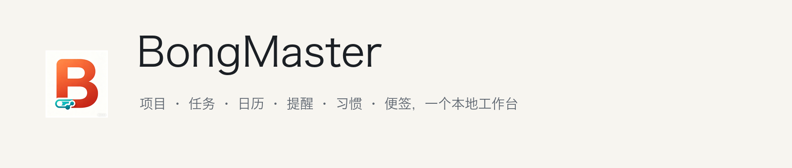
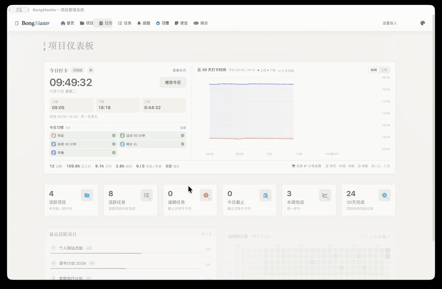
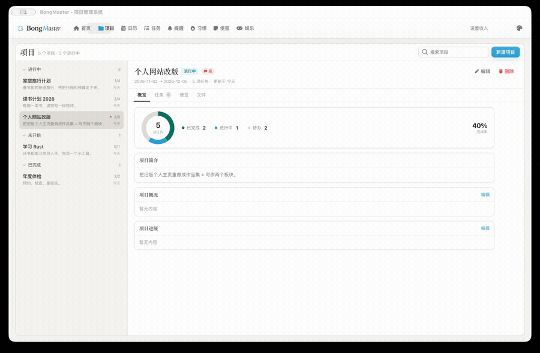
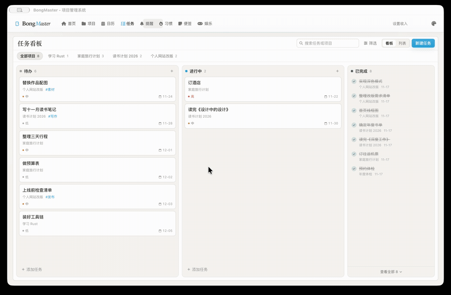
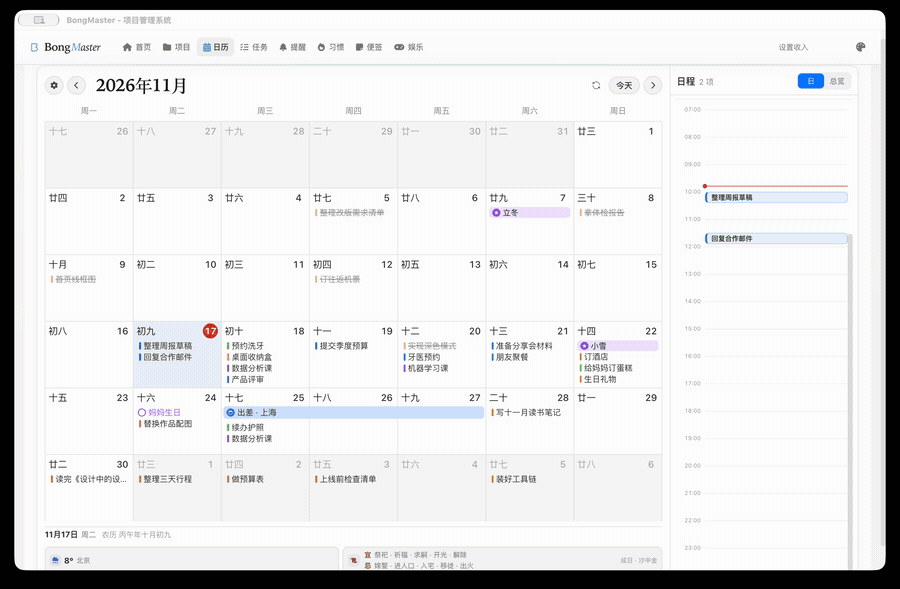
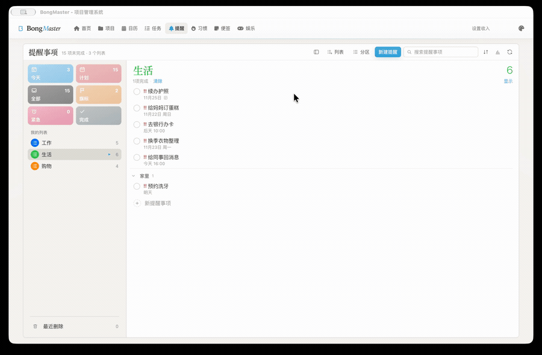
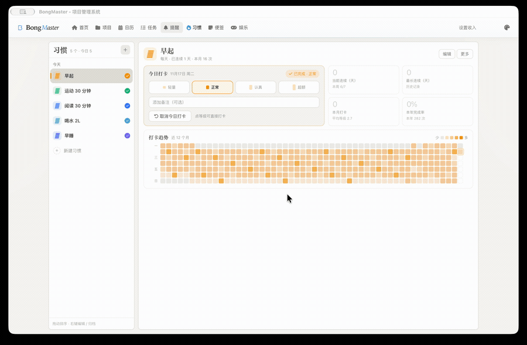
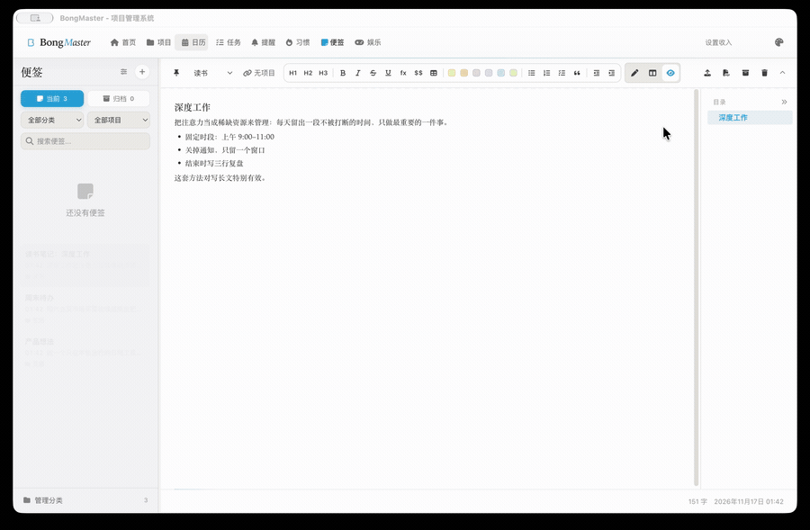
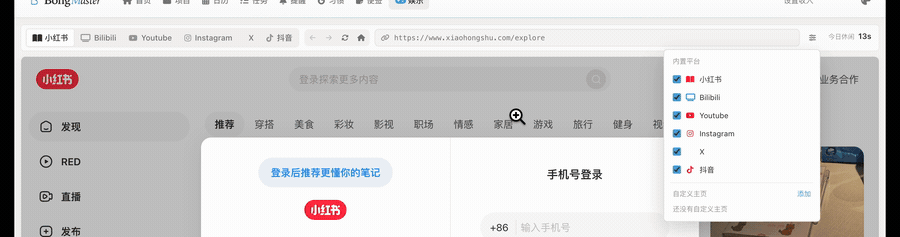

  

**把项目、任务、日历、提醒、习惯和便签放进同一个窗口的本地工作台。**

不用在几个 app 之间来回切换：项目里的任务会出现在看板和日历上，提醒可以按「今天 / 计划 / 旗标」聚到一起，便签可以挂在项目下面，习惯每天打卡后自动生成热力图。所有内容都保存在自己的电脑里。

<table>
<tr><td><b>首页</b></td><td>今日打卡与工时、今日习惯、活跃项目、完成率、活动热力图，一屏看清今天的状态。</td></tr>
<tr><td><b>项目</b></td><td>按状态分组的项目列表，每个项目下有概览、任务、便签和文件，进度一目了然。</td></tr>
<tr><td><b>任务</b></td><td>看板与列表两种视图，按项目筛选，拖拽调整状态。</td></tr>
<tr><td><b>日历</b></td><td>月视图配当日时间轴，农历、节气、宜忌同屏，日程、课程和任务一起显示。</td></tr>
<tr><td><b>提醒</b></td><td>列表与分区、旗标和优先级，今天 / 计划 / 全部一键切换；删除后还能撤销。</td></tr>
<tr><td><b>习惯</b></td><td>每天按「轻量 / 正常 / 认真 / 超额」打卡，连续天数、月历和年度热力图自动统计。</td></tr>
<tr><td><b>便签</b></td><td>Markdown 编辑与预览、目录跳转、分类和项目关联，图片跟着便签一起保存。</td></tr>
<tr><td><b>娱乐</b></td><td>内置常用网站，也可以添加自己的主页；不想看的平台可以直接关掉。</td></tr>
<tr><td><b>同步</b></td><td>日历和提醒与 macOS 同名双向同步，不加前缀；在手机上改完，回到电脑会自动对齐。</td></tr>
</table>

---

## 首页

- 上班、下班一键打卡，自动算出今日工时和近 30 天的平均到岗时间。
- 今日习惯直接勾选，右侧是活跃项目、逾期任务和完成率。
- 活动热力图按天累计完成的任务，左下角是最近活跃的项目。
- 本月收入可以隐藏，或者在设置里换成隐私模式。

## 项目

- 左侧按「进行中 / 未开始 / 已完成」分组，右侧是当前项目的详情。
- 概览页显示任务完成率和项目简介；任务页可以直接勾选完成，进度会实时更新。
- 每个项目还能挂便签和文件，资料不会散落在文件夹里。

## 任务

- 看板按「待办 / 进行中 / 已完成」分列，卡片可以拖动换列。
- 也可以切到列表视图，按截止日期逐条查看。
- 支持按项目筛选，只留当前项目的事情。

## 日历

- 月视图里同时显示农历、节气和节假日。
- 点某一天，右侧展开当天的时间轴；日程、课程和带日期的任务会一起排进去。
- 事件按标签着色，点一下就能看到时间、地点和备注。

## 提醒

- 「今天 / 计划 / 全部 / 旗标 / 紧急」几个视图，把不同来源的提醒聚在一起。
- 列表可以再分区，比如「本周」和「稍后」；完成的提醒会收进完成区。
- 删除的提醒会留在「最近删除」，误删可以找回。

## 习惯

- 每个习惯每天可以选一个完成等级，点一下就算打卡。
- 连续天数、本周完成度、本月次数和年度热力图都会自动更新。
- 支持拖动排序，右键可以编辑或归档。

## 便签

- 左边是便签列表，右边是编辑区，支持 Markdown 和实时预览。
- 可以按分类和项目筛选，长文会自动生成目录。
- `Ctrl` + 滚轮或 `Ctrl` + `+` / `-` 缩放当前便签，`Ctrl` + `0` 回到默认大小；每张便签各自记住自己的缩放。
- 粘贴进来的图片会保存在本地，原图删掉也还能看。

## 娱乐

- 内置小红书、Bilibili、YouTube、Instagram、X 和抖音。
- 点右上角的滑杆图标，可以勾选要显示的平台；也可以添加自己的主页。
- 今日休闲时间会顺手记在右上角。

## 和 macOS 同步

- 日历和提醒都和系统 app 双向同步：在 Mac 上改，BongMaster 会更新；在这里改，系统 app 也会更新。
- 名称保持一致，不会额外加前缀；新建的列表和日历会用同名对应。
- 同步在后台定时进行，不需要手动点。

## 安装

适用于 macOS（Apple Silicon）。

1. 打开 [Releases](https://github.com/runfengyang/BongMaster/releases/latest)，下载最新的 `BongMaster-x.y.z-arm64-mac.zip`。
2. 解压后把 `BongMaster.app` 拖进「应用程序」。
3. 第一次打开如果被系统拦住，右键点应用 →「打开」即可。

## 更新

有新版本时，窗口顶部「本月收入」左边会出现一个「更新」按钮：

- 点一下就会下载新版本，完成后自动重启。
- 没有新版本时，这个按钮不会出现。
- 小改动只提交代码，不单独发版；攒到一版再发布。

## 数据

所有项目、任务、日历、提醒、习惯和便签都保存在本机，不上传云端。换电脑时用应用内的数据导出 / 导入迁移即可。
