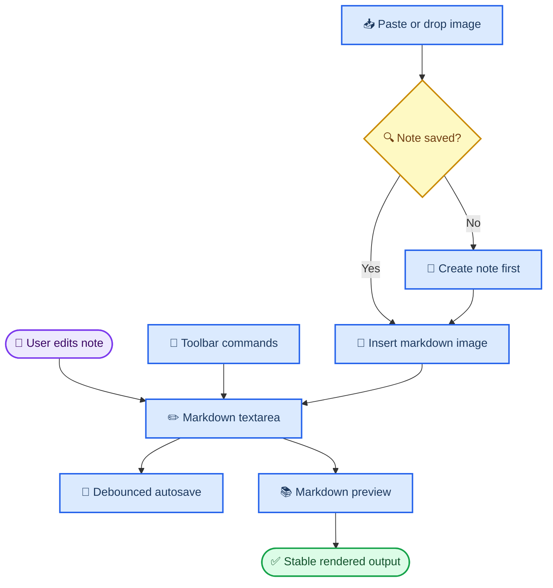
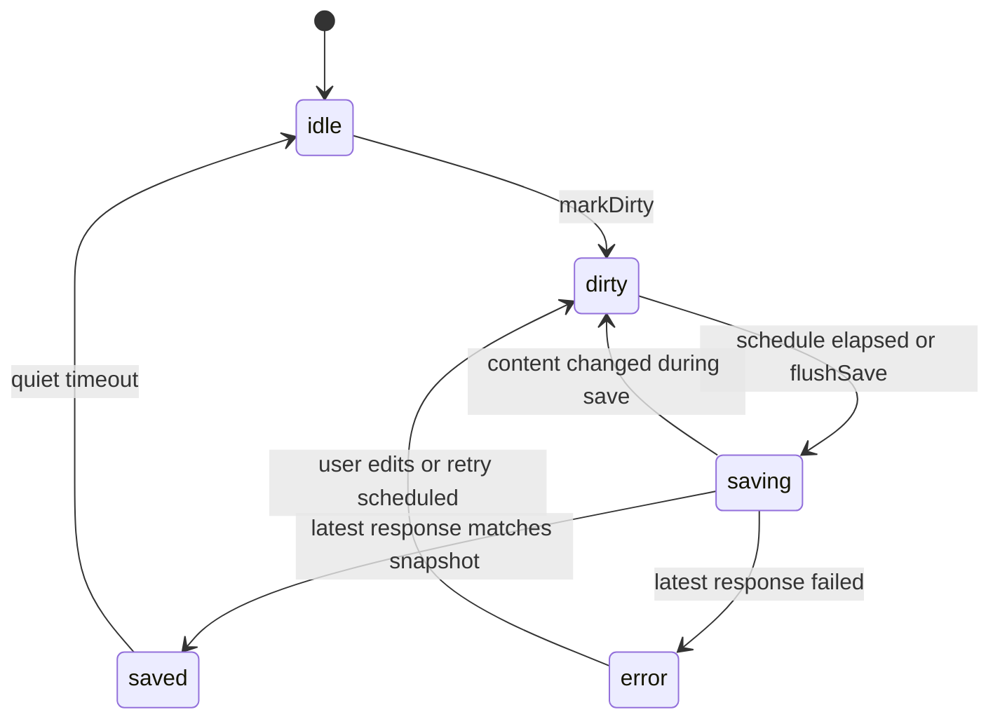
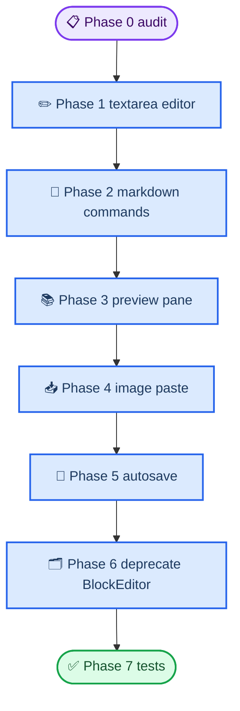

# BongMaster 便签编辑功能优化方案

_面向 AI Agents 的执行规格，参考 `/Users/yangrunfeng/Downloads/floral-notepaper-main`，目标是把当前便签编辑体验从不稳定的自研块编辑器改造成稳定、可预览、可扩展的 Markdown 编辑体验。_

---

## 🎯 目标与结论

当前 BongMaster 的便签编辑难用，根因不是某一个快捷键或 CSS 细节，而是 `BlockEditor.vue` 用自研 `contenteditable` 块编辑器承担了完整富文本编辑器复杂度。光标漂移、表格编辑不自然、有序列表编号错乱、Enter 行为不一致，都是这个架构的典型代价。

参考 Floral Notepaper 后，推荐把便签正文编辑主路径改为 **textarea Markdown 编辑器 + 预览面板 + 稳定工具栏**。复杂 Markdown 继续由预览层渲染，不在编辑层模拟富文本 DOM。这样可以立刻获得稳定光标、天然多行、可控快捷键、好测试的保存流程，同时保留 Markdown、LaTeX、图片、表格等能力。

> **关键决策:** `BlockEditor.vue` 不再作为默认编辑器。默认编辑器应是稳定 textarea；`BlockEditor.vue` 可以暂时保留为实验组件或删除。

## 🔍 参考项目观察

Floral Notepaper 的核心编辑体验来自以下模块：

| 能力 | 参考文件 | 可借鉴点 |
| --- | --- | --- |
| 主编辑器 | `/Users/yangrunfeng/Downloads/floral-notepaper-main/src/components/NotePad.tsx` | 使用 `textarea` 编辑正文，`input` 编辑标题；900ms 自动保存；明确保存状态 |
| Markdown 预览 | `/Users/yangrunfeng/Downloads/floral-notepaper-main/src/features/markdown/MarkdownPreview.tsx` | GFM、数学公式、代码复制、表格、图片路径解析、可选 HTML 渲染 |
| 图片粘贴拖拽 | `/Users/yangrunfeng/Downloads/floral-notepaper-main/src/features/images/useImagePaste.ts` | 图片先确保 note 已保存，再插入 Markdown 图片语法；用 textarea 光标插入 |
| 滚动同步 | `/Users/yangrunfeng/Downloads/floral-notepaper-main/src/features/markdown/scrollSync.ts` | 通过逻辑块映射 textarea 与 preview 的 scroll offset |
| 右键菜单 | `/Users/yangrunfeng/Downloads/floral-notepaper-main/src/components/ContextMenu.tsx` | 编辑区统一 Cut/Copy/Paste/Select all，避免浏览器默认菜单不一致 |
| 保存策略 | `/Users/yangrunfeng/Downloads/floral-notepaper-main/src/features/windows/noteSurfaceSavePolicy.ts` | 明确自动保存、手动保存、切换状态时的保存策略 |

Floral 的重点不是功能堆砌，而是把“编辑中”保持为原生文本控件，把“显示效果”交给 Markdown preview。BongMaster 应采用同样分工。

## ⚠️ 当前问题清单

| 问题 | 当前位置 | 用户感受 | 技术原因 |
| --- | --- | --- | --- |
| 光标乱跳 | `src/components/BlockEditor.vue` | 打字时光标回开头或跳出单元格 | `contenteditable` 与 Vue 响应式重渲染冲突 |
| 表格不可预测 | `BlockEditor.vue`, `src/utils/block-editor.js` | 单元格换行、Tab、保存后结构都脆弱 | Markdown 表格被拆成自研表格 UI，再序列化回文本 |
| 列表难用 | `BlockEditor.vue`, `block-editor.js` | 有序列表编号、Enter 续写、空项退出不稳定 | 块模型与 Markdown 语法双向转换过于简化 |
| 工具栏与编辑状态割裂 | `src/views/NotepadView.vue` | 点按钮后焦点、选区、插入位置不稳定 | 工具栏命令需要跨块操作 DOM selection |
| 自动保存风险 | `NotepadView.vue` | 快速切换/保存时可能覆盖新内容 | 保存请求缺少版本/内容快照校验 |
| 测试覆盖不足 | 无 | 每次修一个交互都可能破坏另一个 | 缺少 parser、保存、快捷键、图片粘贴测试 |

## 🧭 推荐架构



### Target component map

| New/changed file | Responsibility |
| --- | --- |
| `src/components/MarkdownTextareaEditor.vue` | Stable textarea editor, title input, key handling, selection-aware insert helpers |
| `src/components/MarkdownPreviewPane.vue` | Render sanitized Markdown using existing `src/utils/markdown.js` |
| `src/composables/useMarkdownCommands.js` | Bold, italic, headings, lists, quote, table, code, math, links, image insertion |
| `src/composables/useAutosaveNote.js` | Debounced save, stale response guard, flush-before-switch |
| `src/composables/useTextareaImagePaste.js` | Adapt current image paste behavior to textarea insertion and note-first save |
| `src/views/NotepadView.vue` | Host layout, toolbar, note selection, mode toggles, save state |
| `src/components/BlockEditor.vue` | Deprecated or hidden behind experimental flag |

## 🧩 UX specification

### Editing modes

Implement three modes in the editor header:

| Mode | Layout | Purpose |
| --- | --- | --- |
| `edit` | textarea only | Fast writing; the mode a brand-new note opens in |
| `split` | textarea left, preview right | Long-form notes, tables, formulas |
| `preview` | rendered Markdown only | Reading/reviewing; the mode an existing note opens in |

Opening an existing note defaults to `preview` (eye) at every viewport width; a newly created note opens in `edit`; `split` remains available from the mode switch.

### Keyboard behavior

| Input | Expected behavior |
| --- | --- |
| `Enter` | Native newline in textarea |
| `Tab` | Insert two spaces or indent selected lines |
| `Shift+Tab` | Outdent selected lines |
| `Cmd/Ctrl+S` | Flush save immediately |
| `Cmd/Ctrl+B` | Wrap selection with `**` |
| `Cmd/Ctrl+I` | Wrap selection with `*` |
| `Cmd/Ctrl+K` | Insert Markdown link |
| `Cmd/Ctrl+Z/Y` | Native browser undo/redo; do not custom intercept unless required |

### Toolbar commands

Toolbar commands must operate on textarea selection only. They should not inspect rendered preview DOM.

| Command | Output |
| --- | --- |
| H1/H2/H3 | Prefix current lines with `#`, `##`, `###` |
| Bold/Italic/Delete | Wrap selected text |
| Inline math | `$selected$` |
| Display math | `$$\nselected\n$$` |
| Bullet list | Prefix selected lines with `- ` |
| Ordered list | Prefix selected lines with `1.`, `2.`, `3.` |
| Todo | Prefix selected lines with `- [ ] ` |
| Quote | Prefix selected lines with `> ` |
| Table | Insert a Markdown table template |
| Image | Insert `` at cursor after upload/paste |

### Table editing policy

Do **not** build a table cell editor in phase 1. Tables should be edited as Markdown text and rendered in preview.

Required table helpers:

- Toolbar inserts a 3x2 table template
- `Tab` in textarea indents text globally, not cell navigation
- Preview renders GFM table cleanly
- Later phase may add a modal “table assistant” that edits table Markdown separately

This is intentionally less fancy but much more reliable.

### Autosave behavior

Autosave should follow a “snapshot save” policy:

1. Capture `{ noteId, title, content, category, project_ids, requestSeq }` before saving
2. Set state to `saving`
3. If a newer save request starts, older responses must not overwrite current editor state
4. On success, only mark `saved` when current textarea content still matches the saved snapshot
5. On failure, keep content untouched and show `save failed`

### Error and status behavior

| State | UI |
| --- | --- |
| Dirty | `未保存` |
| Saving | `保存中...` |
| Saved | `已保存` for 2 seconds, then quiet |
| Failed | `保存失败` with retry button |
| Offline/API missing | Non-blocking toast or footer text |

## 🛠️ Implementation plan for AI agents

### Agent operating protocol

Every agent working on this plan must follow this protocol:

1. Read this full document before editing files
2. Inspect the current versions of all files listed in the phase before editing
3. Make one phase-sized change at a time
4. Run `npm run build:vite` after every phase
5. Do not modify database schema unless the user explicitly approves
6. Do not delete `BlockEditor.vue` in the first implementation PR
7. Keep changes scoped to notepad editing unless a shared utility is genuinely required
8. If a task conflicts with existing code, preserve data safety and cursor stability over feature richness
9. Record deviations in the implementation summary

### Current-state audit required before coding

Before implementing phase 1, the agent must inspect and summarize these files:

| File | What to inspect |
| --- | --- |
| `src/views/NotepadView.vue` | Toolbar layout, `editTitle`, `editContent`, save flow, selected note switching |
| `src/components/BlockEditor.vue` | Public exposed methods currently used by `NotepadView.vue` |
| `src/utils/markdown.js` | Rendering capabilities, sanitize policy, image path behavior |
| `src/composables/useImagePaste.js` | Existing image save API, insertion behavior, note ID handling |
| `src/stores/notepad-store.js` | `createNote`, `updateNote`, `setNoteProjects`, sorted notes update behavior |
| `electron/preload.js` | Exposed note/image APIs available to renderer |
| `electron/main.js` | IPC handlers for note/image APIs |

Audit output should answer:

- Which component currently owns title editing?
- Which component currently owns content editing?
- Which object is saved to `updateDesktopNote`?
- How are image paths stored?
- Does the current note auto-save before switching notes?
- Which toolbar commands need to be preserved on day one?

### Current implementation anchors

The current implementation has several concrete anchors that agents must account for during migration:

| Area | Current anchor | Migration implication |
| --- | --- | --- |
| Editor import | `src/views/NotepadView.vue` imports `BlockEditor` | Replace import with `MarkdownTextareaEditor` and `MarkdownPreviewPane` |
| Title input | `NotepadView.vue` owns `<input class="editor-title">` | Move title input into `MarkdownTextareaEditor.vue` to keep focus choreography local |
| Content model | `editContent` is passed through `v-model` to `BlockEditor` | Keep `editContent` as the single source of truth; bind it to textarea editor |
| Toolbar commands | `applyMarkdownCommand(command)` calls `contentRef.value?.applyMarkdownCommand?.(command)` | Preserve this public method name or add a compatibility alias |
| Autosave timer | `saveTimer` in `NotepadView.vue` schedules `saveCurrentNote` after 900ms | Move timer/sequence logic into `useAutosaveNote.js` |
| Save payload | `saveCurrentNote` sends `{ title, content, is_pinned, category, project_ids }` | Preserve exact payload shape unless store/API is intentionally changed |
| Store update | `notepadStore.updateNote(id, updateData)` replaces item in `notes` | Guard editor state from store refresh while dirty/saving |
| Store watcher | `watch(() => notepadStore.notes, ...)` overwrites editor only when `saveState === 'idle'` | Keep same protection and extend it to `saving/error` |
| Apple Notes sync | `syncCurrentNoteToAppleNotes` calls `flushPendingSave()` first | New autosave composable must expose `flushSave` for this path |
| PDF export | `exportCurrentNoteToPdf` calls `flushPendingSave()` first | New autosave composable must expose `flushSave` for this path |
| Image API | `src/composables/useImagePaste.js` uses `window.electronAPI.saveImage(noteId, base64, ext)` | Reuse API, but ensure unsaved notes are created before upload |
| Markdown render | `src/utils/markdown.js` exports `renderMarkdown(content, baseDir)` | Preview pane should reuse it instead of introducing a second renderer |

Do not treat these as incidental details. They are the contracts that let the editor change without breaking note storage, sidebar previews, Apple Notes sync, PDF export, and project/category metadata.

### Floral behavior to port

Port the following patterns from Floral Notepaper conceptually, not line-for-line:

| Floral file | Behavior to port | BongMaster target |
| --- | --- | --- |
| `NotePad.tsx` | `title` and `content` are controlled state; `contentRef` is a textarea | `MarkdownTextareaEditor.vue` exposes textarea methods and emits controlled updates |
| `NotePad.tsx` | `contentValueRef/titleValueRef` compare latest values after save | `useAutosaveNote.js` compares current snapshot against saved snapshot before marking saved |
| `NotePad.tsx` | `ensureNoteSaved` creates note before image paste | `useTextareaImagePaste.js` receives `ensureNoteSaved` and never uploads to null note |
| `useImagePaste.ts` | Process image files, insert `` at textarea cursor | Vue composable inserts Markdown through textarea selection APIs |
| `MarkdownPreview.tsx` | Preview is read-only and handles GFM/math/images | `MarkdownPreviewPane.vue` renders sanitized HTML from existing `renderMarkdown` |
| `scrollSync.ts` | Scroll sync is separate optional logic | BongMaster scroll sync is Phase 8 only, after editor stability |

Important difference: Floral is React/Tauri; BongMaster is Vue/Electron. Agents should port the interaction model and safety rules, not React hooks or Tauri APIs.

### Data invariants

Agents must preserve these invariants:

| Invariant | Reason |
| --- | --- |
| `desktop_notes.content` remains a Markdown string | Existing notes, Apple Notes sync, PDF export, and previews depend on Markdown |
| `desktop_notes.title` remains plain text | Sidebar and search expect plain title |
| Image references remain `` | Existing `renderMarkdown` resolves local image paths |
| `project_ids` remains an array of numeric IDs in renderer state | Project association UI depends on it |
| Existing categories remain string labels | Category filter and save payload depend on it |
| No note content is rewritten merely by opening it | Prevent silent data churn and accidental formatting changes |

### Target editor contracts

#### `MarkdownTextareaEditor.vue`

Create `src/components/MarkdownTextareaEditor.vue`.

Props:

| Prop | Type | Default | Notes |
| --- | --- | --- | --- |
| `title` | `String` | `''` | Controlled title value |
| `modelValue` | `String` | `''` | Controlled Markdown content |
| `placeholder` | `String` | `'开始写作...'` | Textarea placeholder |
| `noteId` | `String | Number | null` | Used by image paste |
| `fontSize` | `Number` | `16` | Optional future setting |
| `disabled` | `Boolean` | `false` | For saving/exporting locks if needed |

Emits:

| Event | Payload | When |
| --- | --- | --- |
| `update:title` | `string` | Title input changes |
| `update:modelValue` | `string` | Textarea changes |
| `input` | none | Any title/content edit should mark dirty upstream |
| `save` | none | `Cmd/Ctrl+S` from inside editor |
| `focus` | none | Textarea receives focus |
| `blur` | none | Textarea loses focus |

Refs:

- `titleInputRef`
- `textareaRef`

Expose:

| Method | Signature | Behavior |
| --- | --- | --- |
| `focus` | `() => void` | Focus textarea |
| `focusTitle` | `() => void` | Focus title input |
| `getSelection` | `() => { start, end }` | Return textarea selection |
| `setSelection` | `(start, end = start) => void` | Restore textarea selection |
| `insertText` | `(text, options?) => void` | Insert text at cursor and emit update |
| `applyCommand` | `(command) => void` | Run command through `useMarkdownCommands` |

Internal keyboard behavior:

- Title `Enter` or `ArrowDown`: focus textarea
- Textarea `ArrowUp` on first line: focus title
- Textarea `Tab`: indent selected lines or insert two spaces
- Textarea `Shift+Tab`: outdent selected lines
- Textarea `Cmd/Ctrl+S`: emit `save`
- Textarea should not intercept native undo/redo

#### `MarkdownPreviewPane.vue`

Create `src/components/MarkdownPreviewPane.vue`.

Props:

| Prop | Type | Default | Notes |
| --- | --- | --- | --- |
| `content` | `String` | `''` | Markdown content |
| `imageBaseDir` | `String` | `''` | Passed to `renderMarkdown` |
| `emptyText` | `String` | `'预览区会显示当前便签内容'` | Empty state |

Behavior:

- Render via `renderMarkdown(content, imageBaseDir)`
- Use `v-html` only with sanitized output from `renderMarkdown`
- Keep preview selectable
- Do not make preview content editable
- Add a scroll container ref for future scroll sync

#### `useMarkdownCommands.js`

Create `src/composables/useMarkdownCommands.js`.

This composable should expose pure string helpers and one DOM helper layer. Keep most logic testable without Vue.

Pure helper contracts:

```js
export function wrapSelection(value, start, end, before, after = before, placeholder = '')
export function prefixSelectedLines(value, start, end, prefixFactory)
export function insertBlock(value, start, end, blockText)
export function indentSelectedLines(value, start, end, indent = '  ')
export function outdentSelectedLines(value, start, end, indentSize = 2)
export function createTableTemplate(columns = 3, rows = 2)
export function applyMarkdownCommandToValue(value, start, end, command)
```

Return shape for pure helpers:

```js
{
  value: string,
  selectionStart: number,
  selectionEnd: number
}
```

Command names to support:

| Command | Required output |
| --- | --- |
| `bold` | `**selection**` |
| `italic` | `*selection*` |
| `strikethrough` | `~~selection~~` |
| `underline` | `<ins>selection</ins>` |
| `inlineMath` | `$selection$` |
| `displayMath` | `$$\nselection\n$$` |
| `heading1` | Prefix current selected lines with `# ` |
| `heading2` | Prefix current selected lines with `## ` |
| `heading3` | Prefix current selected lines with `### ` |
| `bulletList` | Prefix selected lines with `- ` |
| `orderedList` | Prefix selected lines with incrementing `1. `, `2. ` |
| `todo` | Prefix selected lines with `- [ ] ` |
| `quote` | Prefix selected lines with `> ` |
| `table` | Insert table template |
| `codeBlock` | Insert fenced code block |
| `link` | `[selection](url)` |
| `indent` | Indent selected lines |
| `outdent` | Outdent selected lines |

Selection rules:

- Empty selection uses command-specific placeholder
- Multiline selected text keeps all original line breaks
- Prefix commands should preserve original indentation where possible
- After placeholder insertion, select only placeholder text so user can overwrite immediately
- After wrapping existing selection, place cursor after inserted wrapper

#### `useAutosaveNote.js`

Create `src/composables/useAutosaveNote.js`.

Inputs:

| Input | Type |
| --- | --- |
| `getSnapshot` | function returning current save payload |
| `saveSnapshot` | async function that persists payload |
| `delay` | number, default `900` |
| `onStateChange` | callback for `dirty/saving/saved/error` |
| `onSaved` | callback with saved note |
| `onError` | callback with error |

Expose:

| Method | Behavior |
| --- | --- |
| `markDirty()` | Set dirty and schedule save |
| `scheduleSave()` | Debounced save |
| `flushSave()` | Immediately save dirty content |
| `cancelSave()` | Clear pending timer |
| `isDirty()` | Boolean |
| `isSaving()` | Boolean |

Stale response guard:

```js
let saveSeq = 0
let latestAppliedSeq = 0

async function runSave() {
  const seq = ++saveSeq
  const snapshot = getSnapshot()
  onStateChange('saving')
  const result = await saveSnapshot(snapshot)
  if (seq < saveSeq) return { stale: true }
  latestAppliedSeq = seq
  onSaved(result, snapshot)
}
```

Important rules:

- `flushSave` must await the active save if one is already running
- Stale responses must not overwrite editor content
- Failed saves must not clear dirty state
- `onUnmounted` should flush or explicitly skip based on caller policy

#### `useTextareaImagePaste.js`

Create `src/composables/useTextareaImagePaste.js` or refactor `src/composables/useImagePaste.js` to support textarea-first editor.

Inputs:

| Input | Type | Purpose |
| --- | --- | --- |
| `textareaRef` | ref | Insertion target |
| `noteId` | ref/computed | Existing note ID |
| `ensureNoteSaved` | async function | Save/create note before image upload |
| `setContent` | function | Update controlled textarea value |
| `markDirty` | function | Mark editor dirty |
| `onError` | function | Display error |

Rules:

- Accept png, jpg, jpeg, gif, webp, bmp, svg
- Reject files over 20 MB
- For new notes, call `ensureNoteSaved` before saving image
- Insert images as Markdown lines
- Preserve cursor after insertion
- Use native textarea selection, not `contenteditable`

### NotepadView integration contract

`src/views/NotepadView.vue` should own page-level state only:

| State | Owner |
| --- | --- |
| `selectedNote` | `NotepadView.vue` |
| `editTitle` | `NotepadView.vue` |
| `editContent` | `NotepadView.vue` |
| `selectedNoteCategory` | `NotepadView.vue` |
| `selectedNoteProjectIds` | `NotepadView.vue` |
| `editorMode` | `NotepadView.vue` |
| toolbar command dispatch | `NotepadView.vue` |
| title/content input mechanics | `MarkdownTextareaEditor.vue` |
| Markdown command text transforms | `useMarkdownCommands.js` |
| save scheduling | `useAutosaveNote.js` |

Template replacement target:

```vue
<MarkdownTextareaEditor
  ref="contentRef"
  v-model:title="editTitle"
  v-model="editContent"
  :note-id="selectedNote?.id"
  placeholder="开始写作..."
  @input="onEditorInput"
  @save="flushPendingSave"
/>
```

Split preview target:

```vue
<div class="editor-workspace" :class="`mode-${editorMode}`">
  <MarkdownTextareaEditor v-if="editorMode !== 'preview'" ... />
  <MarkdownPreviewPane v-if="editorMode !== 'edit'" :content="editContent" />
</div>
```

Toolbar dispatch:

```js
const applyMarkdownCommand = (command) => {
  contentRef.value?.applyCommand?.(command)
}
```

Compatibility requirement:

```js
const applyCommand = (command) => {
  // New method name
}

const applyMarkdownCommand = applyCommand

defineExpose({
  focus,
  focusTitle,
  getSelection,
  setSelection,
  insertText,
  applyCommand,
  applyMarkdownCommand
})
```

This compatibility alias lets `NotepadView.vue` migrate in two smaller steps: first replace the component, then simplify command wiring.

## 🧱 File-level execution cards

This section is the most important part for agents. Treat each card as an implementation ticket with explicit input, edit scope, and exit criteria.

### Card A: `useMarkdownCommands.js`

Purpose: make all toolbar commands pure, deterministic, and testable.

Edit scope:

- Add `src/composables/useMarkdownCommands.js`
- Do not import Vue in pure helper functions
- Do not read or write DOM in pure helper functions

Implementation shape:

```js
function normalizeSelection(value, start, end) {
  const safeStart = Math.max(0, Math.min(start ?? 0, value.length))
  const safeEnd = Math.max(safeStart, Math.min(end ?? safeStart, value.length))
  return { start: safeStart, end: safeEnd }
}

function updateValue(value, start, end, replacement, nextSelectionStart, nextSelectionEnd) {
  return {
    value: value.slice(0, start) + replacement + value.slice(end),
    selectionStart: nextSelectionStart,
    selectionEnd: nextSelectionEnd
  }
}
```

Required command behavior:

| Command | Empty selection | Existing selection |
| --- | --- | --- |
| `bold` | Insert `**加粗文本**` and select `加粗文本` | Wrap with `**` |
| `italic` | Insert `*斜体文本*` and select `斜体文本` | Wrap with `*` |
| `strikethrough` | Insert `~~删除线文本~~` | Wrap with `~~` |
| `underline` | Insert `<ins>下划线文本</ins>` | Wrap with `<ins>` and `</ins>` |
| `inlineMath` | Insert `$x$` and select `x` | Wrap with `$` |
| `displayMath` | Insert `$$\nx\n$$` and select `x` | Wrap block with `$$` lines |
| `heading1/2/3` | Prefix current line | Prefix every selected line |
| `bulletList` | Prefix current line with `- ` | Prefix every selected line |
| `orderedList` | Prefix current line with `1. ` | Prefix selected lines with increasing numbers |
| `todo` | Prefix with `- [ ] ` | Prefix every selected line |
| `quote` | Prefix with `> ` | Prefix every selected line |
| `indent` | Insert two spaces or indent selected lines | Indent every selected line |
| `outdent` | Remove up to two leading spaces | Outdent every selected line |
| `table` | Insert valid 3-column, 2-row table | Replace selection with table |
| `codeBlock` | Insert fenced block | Wrap selected text in fenced block |
| `link` | Insert `[链接文本](url)` | Convert selection to `[selection](url)` |
| `highlightYellow` | Insert `<mark class="bm-highlight-yellow">高亮文本</mark>` | Wrap selection with mark |

Line-prefix algorithm:

1. Find the start index of the first selected line by searching backward for `\n`
2. Find the end index of the last selected line by searching forward for `\n`
3. Split only that line range
4. Prefix non-empty lines; for empty selected line, create a prefix-only line
5. Reassemble `before + transformedRange + after`
6. Return selection that covers transformed lines

Ordered-list algorithm:

```js
prefixSelectedLines(value, start, end, (line, index) => `${index + 1}. `)
```

Do not use Markdown's repeated `1.` style for inserted text here. The preview renderer may normalize numbering, but the editing experience should show `1.`, `2.`, `3.` because the user explicitly complained about repeated numbering.

Exit criteria:

- Pure helpers return the exact `{ value, selectionStart, selectionEnd }` shape
- No helper mutates arguments
- Multiline Chinese text preserves original line breaks
- Ordered list never creates `1. 1. 1.` for selected lines

### Card B: `MarkdownTextareaEditor.vue`

Purpose: replace unstable `contenteditable` editing with native textarea behavior.

Edit scope:

- Add `src/components/MarkdownTextareaEditor.vue`
- Do not import `BlockEditor`
- Do not render Markdown inside this component

Template structure:

```vue
<template>
  <section class="markdown-textarea-editor" :class="{ disabled, dragging: isDraggingImage }">
    <input
      ref="titleInputRef"
      class="markdown-title-input"
      :value="title"
      :disabled="disabled"
      placeholder="标题"
      @input="handleTitleInput"
      @keydown="handleTitleKeydown"
    />
    <textarea
      ref="textareaRef"
      class="markdown-body-textarea"
      :value="modelValue"
      :placeholder="placeholder"
      :disabled="disabled"
      :style="{ fontSize: `${fontSize}px` }"
      spellcheck="true"
      @input="handleContentInput"
      @keydown="handleContentKeydown"
      @compositionstart="isComposing = true"
      @compositionend="isComposing = false"
      @paste="handlePaste"
      @drop="handleDrop"
      @dragover="handleDragOver"
      @dragleave="handleDragLeave"
    />
  </section>
</template>
```

Behavior rules:

- `handleContentInput` emits `update:modelValue` with `event.target.value`, then emits `input`
- `handleTitleInput` emits `update:title`, then emits `input`
- `handleContentKeydown` ignores formatting shortcuts while `isComposing` is true
- `Cmd/Ctrl+S` prevents default and emits `save`
- `Tab` prevents default and applies `indent`
- `Shift+Tab` prevents default and applies `outdent`
- `Enter` is not intercepted in textarea
- `ArrowUp` on first content line focuses title only when selection starts at line 0
- `title Enter` focuses textarea

DOM update rule:

After applying a command:

```js
emit('update:modelValue', next.value)
emit('input')
await nextTick()
textareaRef.value?.focus()
textareaRef.value?.setSelectionRange(next.selectionStart, next.selectionEnd)
```

This order matters. Selection should be restored after Vue patches the controlled textarea value.

CSS contract:

```css
.markdown-textarea-editor {
  min-height: 0;
  height: 100%;
  display: grid;
  grid-template-rows: auto minmax(0, 1fr);
}

.markdown-title-input {
  width: 100%;
  flex: none;
}

.markdown-body-textarea {
  min-height: 0;
  width: 100%;
  height: 100%;
  resize: none;
  overflow: auto;
  line-height: 1.7;
  white-space: pre-wrap;
}
```

Exit criteria:

- No contenteditable usage
- No cursor-reset during typing
- Textarea fills available editor body height
- Title and body focus behavior feels natural
- Component exposes both `applyCommand` and `applyMarkdownCommand`

### Card C: `MarkdownPreviewPane.vue`

Purpose: render Markdown without affecting editor DOM or cursor.

Edit scope:

- Add `src/components/MarkdownPreviewPane.vue`
- Reuse `renderMarkdown`
- Add local CSS for rendered content if existing global styles are insufficient

Implementation shape:

```vue
<template>
  <aside ref="previewRef" class="markdown-preview-pane">
    <div v-if="!content.trim()" class="markdown-preview-empty">{{ emptyText }}</div>
    <div v-else class="markdown-preview-content" v-html="html"></div>
  </aside>
</template>
```

Computed:

```js
const html = computed(() => renderMarkdown(props.content, props.imageBaseDir))
```

Preview CSS requirements:

| Element | Requirement |
| --- | --- |
| `table` | Full width when possible, collapsed borders, horizontal overflow wrapper if wide |
| `pre` | Horizontal scroll, no layout expansion |
| `code` | Monospace, readable contrast |
| `img` | `max-width: 100%`, preserve aspect ratio |
| `blockquote` | Left border, restrained background |
| `.note-math-display` | Horizontal scroll if formula is wide |
| `a` | Open external links safely if click handling exists; otherwise normal anchor |

Exit criteria:

- Preview never uses `contenteditable`
- Preview remains selectable
- Tables, math, images, code blocks, blockquotes render without overflowing the viewport

### Card D: `useTextareaImagePaste.js`

Purpose: make pasted/dropped images insert at the textarea cursor and work for unsaved notes.

Edit scope:

- Prefer adding `src/composables/useTextareaImagePaste.js`
- Keep existing `src/composables/useImagePaste.js` available until no callers use it

Processing algorithm:

1. Extract all supported image files from paste/drop event
2. If no images, return `false` so normal text paste continues
3. Prevent default for image paste/drop
4. If `processing` is true, return
5. Resolve note ID:
   - If `noteId` exists, use it
   - Else call `ensureNoteSaved()`
   - If still no note ID, call `onError('请先保存便签后再插入图片')`
6. Convert each image to base64
7. Call `window.electronAPI.saveImage(resolvedNoteId, base64, ext)`
8. Collect relative paths
9. Insert Markdown at textarea selection:
   - Add leading newline if cursor is after non-newline text
   - Join multiple images with `\n`
   - Add trailing newline
10. Emit updated content through `setContent`
11. Restore cursor after inserted Markdown
12. Call `markDirty`

Exit criteria:

- Existing text paste still works
- Single image paste works
- Multiple image drop works
- Oversized image reports error and does not mutate content
- Failed upload reports error and does not mutate content

### Card E: `useAutosaveNote.js`

Purpose: centralize dirty/saving/saved/error state and prevent stale writes from corrupting editor state.

Edit scope:

- Add `src/composables/useAutosaveNote.js`
- Integrate it in `NotepadView.vue`
- Remove raw `saveTimer` from `NotepadView.vue` after integration

State machine:



Required guards:

| Guard | Required behavior |
| --- | --- |
| `seq < saveSeq` | Treat response as stale; do not update UI state except internal bookkeeping |
| `snapshot.noteId !== current.noteId` | Do not apply saved note to selected editor |
| `snapshot.content !== current.content` | Do not mark saved; keep dirty |
| `snapshot.title !== current.title` | Do not mark saved; keep dirty |
| Save returns null | Set `error`, keep dirty content |
| Component unmount | Try `flushSave`; if not awaited by lifecycle, at least cancel timer and log risk |

Exit criteria:

- Rapid typing cannot be overwritten by an older save response
- Store watcher cannot overwrite dirty/saving content
- `flushSave` is awaited before note switching, Apple Notes sync, PDF export, and delete

### Card F: `NotepadView.vue` migration

Purpose: wire new editor, preview, commands, and autosave while preserving existing note metadata.

Minimum diff sketch:

```diff
- import BlockEditor from '@components/BlockEditor.vue'
+ import MarkdownTextareaEditor from '@components/MarkdownTextareaEditor.vue'
+ import MarkdownPreviewPane from '@components/MarkdownPreviewPane.vue'
+ import { useAutosaveNote } from '@composables/useAutosaveNote.js'
```

Template migration:

```diff
- <input ref="titleRef" ... v-model="editTitle" ... />
- <BlockEditor ref="contentRef" ... v-model="editContent" ... />
+ <div class="editor-mode-switch" role="tablist" aria-label="编辑模式">
+   ...
+ </div>
+ <div class="editor-workspace" :class="`mode-${editorMode}`">
+   <MarkdownTextareaEditor
+     v-if="editorMode !== 'preview'"
+     ref="contentRef"
+     v-model:title="editTitle"
+     v-model="editContent"
+     :note-id="selectedNote?.id"
+     @input="onEditorInput"
+     @save="flushPendingSave"
+   />
+   <MarkdownPreviewPane
+     v-if="editorMode !== 'edit'"
+     :content="editContent"
+     :image-base-dir="imageBaseDir"
+   />
+ </div>
```

State changes:

| Current | Target |
| --- | --- |
| `titleRef` in `NotepadView.vue` | Removed or delegated to `contentRef.value.focusTitle()` |
| `saveTimer` local variable | Removed; owned by `useAutosaveNote` |
| `onInput` | Rename to `onEditorInput`, calls `autosave.markDirty()` |
| `flushPendingSave` | Wrapper around `autosave.flushSave()` |
| `saveCurrentNote` | Becomes `saveSnapshot(snapshot)` or internal helper passed to composable |
| `saveState` | Either owned by composable or mirrored from composable state |
| `editorMode` | Add `ref(window.innerWidth >= 900 ? 'split' : 'edit')` |

Critical save snapshot shape:

```js
const getSaveSnapshot = () => ({
  noteId: selectedNote.value?.id ?? null,
  title: editTitle.value,
  content: editContent.value,
  is_pinned: selectedNote.value?.is_pinned ?? false,
  category: selectedNoteCategory.value,
  project_ids: [...selectedNoteProjectIds.value]
})
```

`saveSnapshot` must call:

```js
notepadStore.updateNote(snapshot.noteId, {
  title: snapshot.title,
  content: snapshot.content,
  is_pinned: snapshot.is_pinned,
  category: snapshot.category,
  project_ids: snapshot.project_ids
})
```

Store watcher replacement rule:

```js
if (updated && autosave.canAcceptExternalUpdate?.()) {
  selectedNote.value = { ...updated }
  editTitle.value = updated.title || ''
  editContent.value = updated.content || ''
}
```

If the composable does not expose `canAcceptExternalUpdate`, use:

```js
saveState.value === 'idle' || saveState.value === 'saved'
```

Do not accept external updates during `dirty`, `saving`, or `error`.

Exit criteria:

- No default template path contains `BlockEditor`
- Toolbar still calls one method on `contentRef`
- Project/category/pin/delete/sync/export still work
- Existing note opening does not rewrite content

### Card G: layout and interaction polish

Purpose: make the new editor feel intentional, not like a raw textarea dropped into the app.

Required layout:

| Viewport | Default mode | Layout |
| --- | --- | --- |
| `>= 1200px` | `preview` | Single rendered pane; `split` widens back into two panes when picked |
| `< 1200px` | `preview` | Single pane; `split` is downgraded to `edit` so the panes never squeeze |

CSS constraints:

```css
.editor-body {
  min-height: 0;
  display: flex;
  flex-direction: column;
}

.editor-workspace {
  min-height: 0;
  flex: 1;
  display: grid;
  gap: 1px;
}

.editor-workspace.mode-split {
  grid-template-columns: minmax(0, 1fr) minmax(0, 1fr);
}

.editor-workspace.mode-edit,
.editor-workspace.mode-preview {
  grid-template-columns: minmax(0, 1fr);
}
```

Interaction polish:

- Toolbar buttons must use `@mousedown.prevent` so they do not steal textarea selection
- Mode switch should remember last choice during current app session
- Save status should stay in footer and not shift layout
- Preview pane should not scroll the whole app shell
- Dragging an image over the textarea should show a clear but non-blocking visual state
- Empty editor should keep title and body placeholders visually quiet

Exit criteria:

- No text overlaps toolbar/footer at 1280px desktop, 900px narrow desktop, and 390px mobile-width devtools viewport
- Switching modes does not resize toolbar buttons or footer
- Long code/table content scrolls inside pane, not across the whole app

### Detailed phase dependencies



### Phase 0: Preserve current behavior

**Goal:** Create a safe baseline before replacing the editor.

Tasks:

- [ ] Add `docs/notepad-editor-optimization-plan.md` to repo
- [ ] Record current editor entry points:
  - `src/views/NotepadView.vue`
  - `src/components/BlockEditor.vue`
  - `src/utils/block-editor.js`
  - `src/utils/markdown.js`
  - `src/composables/useImagePaste.js`
- [ ] Run `npm run build:vite`
- [ ] Manually verify current note select/save still works

Exit criteria:

- Build passes
- No data model changes

### Phase 1: Build stable textarea editor

**Goal:** Replace default editing surface with textarea-backed Markdown editor.

Tasks:

- [ ] Create `src/components/MarkdownTextareaEditor.vue`
- [ ] Props:
  - `modelValue`
  - `title`
  - `placeholder`
  - `noteId`
  - `fontSize`
- [ ] Emits:
  - `update:modelValue`
  - `update:title`
  - `input`
  - `save`
- [ ] Include:
  - title input
  - textarea body
  - exposed methods `focus`, `insertText`, `wrapSelection`, `prefixLines`, `applyCommand`
- [ ] Move Tab/Shift+Tab handling into this component
- [ ] Keep native undo/redo untouched
- [ ] Ensure component CSS uses stable dimensions and does not resize on placeholder/toolbar state
- [ ] Ensure IME composition is not interrupted by key handlers
- [ ] Ensure `input` event is emitted for both title and content changes

Acceptance criteria:

- Typing never moves the cursor unexpectedly
- `Enter` always creates a normal newline
- Large notes remain editable without lag from per-block rendering
- Chinese IME composition works without premature command handling
- Browser undo/redo works across normal typing

### Phase 2: Markdown commands

**Goal:** Make toolbar commands predictable and selection-based.

Tasks:

- [ ] Create `src/composables/useMarkdownCommands.js`
- [ ] Implement pure helpers:
  - `wrapSelection(value, start, end, before, after, placeholder)`
  - `prefixSelectedLines(value, start, end, prefixFactory)`
  - `insertBlock(value, start, end, blockText)`
  - `insertTable(value, start, end)`
- [ ] Unit-test helpers with plain strings
- [ ] Wire `NotepadView.vue` toolbar to `MarkdownTextareaEditor.applyCommand`
- [ ] Support current toolbar commands already visible in `NotepadView.vue`
- [ ] Keep toolbar buttons from stealing textarea focus by using `@mousedown.prevent`
- [ ] Restore textarea selection after command execution

Acceptance criteria:

- Toolbar always modifies text at current textarea selection
- Commands work for empty selection and selected multiline text
- No command reads or mutates preview DOM
- Ordered-list command creates increasing numbers in the inserted Markdown text
- Table command creates valid GFM table Markdown

### Phase 3: Preview pane

**Goal:** Add stable Markdown preview and split mode.

Tasks:

- [ ] Create `src/components/MarkdownPreviewPane.vue`
- [ ] Reuse `renderMarkdown(content, imageBaseDir)` from `src/utils/markdown.js`
- [ ] Add mode state in `NotepadView.vue`: `edit | split | preview`
- [ ] Add toolbar segmented control for mode switching
- [ ] Style preview tables, code blocks, images, blockquotes, math consistently with BongMaster
- [ ] Load image base dir through existing image API or current helper
- [ ] Add empty preview state
- [ ] Ensure preview scroll area does not shift editor toolbar/footer

Acceptance criteria:

- GFM tables render correctly
- Math rendering still works
- Images pasted into note render from local image base dir
- Preview mode is read-only and selectable
- Switching edit/split/preview never changes note content

### Phase 4: Image paste and drag/drop

**Goal:** Make image insertion reliable for new and existing notes.

Tasks:

- [ ] Create `src/composables/useTextareaImagePaste.js` or adapt existing `useImagePaste.js`
- [ ] If note is new/unsaved, save/create note before image upload
- [ ] Insert image Markdown at current textarea cursor with surrounding newlines when needed
- [ ] Preserve cursor after insertion
- [ ] Show non-blocking error on invalid/oversized image
- [ ] Prevent duplicate processing while an image upload is already running
- [ ] Add drag-over visual state on textarea container
- [ ] Ensure save failure before image upload reports a clear error

Acceptance criteria:

- Paste image into empty new note creates/saves note and inserts ``
- Drag image into textarea works
- Multiple images insert as separate Markdown image lines
- Failed image upload never clears content
- Cursor lands after inserted image Markdown

### Phase 5: Autosave hardening

**Goal:** Prevent stale saves and switching-note overwrite bugs.

Tasks:

- [ ] Create `src/composables/useAutosaveNote.js`
- [ ] Add monotonic `saveSeq`
- [ ] Implement `scheduleSave`, `flushSave`, `cancelSave`
- [ ] Before switching notes, call `flushSave`
- [ ] Ignore stale save responses when `saveSeq` is older than latest request
- [ ] Do not replace `editContent` from save response unless same note and same content snapshot
- [ ] Add visible failed-save status and manual retry behavior
- [ ] Ensure `syncCurrentNoteToAppleNotes` and `exportCurrentNoteToPdf` call `flushSave` first
- [ ] Ensure note deletion cancels pending saves for deleted note

Acceptance criteria:

- Rapid typing during autosave does not lose characters
- Switching notes flushes dirty content before selection changes
- Failed save leaves editor content intact
- Apple Notes sync uses latest content
- PDF export uses latest content

### Phase 6: Deprecate BlockEditor safely

**Goal:** Remove the source of current instability without losing code abruptly.

Tasks:

- [ ] Replace `BlockEditor` usage in `NotepadView.vue` with `MarkdownTextareaEditor`
- [ ] Keep `BlockEditor.vue` temporarily unused
- [ ] Add comment at top of `BlockEditor.vue`: deprecated experimental editor
- [ ] After one stable release, delete `BlockEditor.vue` and `src/utils/block-editor.js`
- [ ] Remove imports of `BlockEditor` from `NotepadView.vue`
- [ ] Ensure no default route renders `BlockEditor`
- [ ] Keep `src/utils/block-editor.js` untouched unless tests require small compatibility fixes

Acceptance criteria:

- No default UI path uses `BlockEditor`
- Existing notes still open because storage remains Markdown string
- Build passes without `BlockEditor` references in `NotepadView.vue`

### Phase 7: Tests and regression suite

**Goal:** Make editor behavior safe for future AI changes.

Tasks:

- [ ] Add unit tests for Markdown command helpers
- [ ] Add tests for autosave stale response handling
- [ ] Add tests for image insertion string behavior
- [ ] Add manual QA checklist to PR description
- [ ] Add parser/render smoke tests for `renderMarkdown` table/image/math behavior if test framework exists
- [ ] Add store-level save race tests if test framework exists
- [ ] If no test framework is configured, add documented manual test script under `docs/`

Suggested test cases:

| Area | Case |
| --- | --- |
| Selection | Wrap empty selection with bold placeholder |
| Selection | Wrap selected Chinese text |
| Multiline | Prefix three selected lines as ordered list |
| Table | Insert table into empty note |
| Image | Insert image after existing paragraph with newline |
| Autosave | Older save resolves after newer save |
| Switching | Dirty note saves before selecting another note |

### Phase 8: Optional scroll sync

**Goal:** Add split-pane scroll synchronization after the stable editor is already working.

This phase is optional and should not block the main stabilization.

Tasks:

- [ ] Port the idea from Floral's `scrollSync.ts`
- [ ] Parse Markdown into logical blocks by line number
- [ ] Measure textarea block offsets with a hidden mirror element
- [ ] Tag preview block elements with matching block indices
- [ ] Sync editor-to-preview first
- [ ] Add preview-to-editor only if it feels reliable
- [ ] Throttle or debounce scroll handling
- [ ] Abort stale measurement work when content changes quickly

Acceptance criteria:

- Scroll sync never freezes long notes
- Scroll sync can be disabled if it misbehaves
- No cursor behavior changes are introduced

## 🧪 Detailed manual QA script

Agents must run this script before reporting completion.

### Startup

1. Run `npm run dev`
2. Open `/notepad`
3. Confirm no console errors on initial load
4. Confirm existing notes list loads

### Basic editing

1. Create a new note
2. Type title: `测试标题`
3. Press `Enter`
4. Type 5 lines of Chinese text
5. Move cursor to middle of line 2
6. Type `光标不应该乱跳`
7. Confirm cursor stays after inserted text

### Markdown commands

1. Select one word
2. Click bold
3. Confirm text becomes `**word**`
4. Select three lines
5. Click ordered list
6. Confirm lines become `1.`, `2.`, `3.`
7. Insert table from toolbar
8. Confirm table appears as plain Markdown in editor and rendered table in preview

### Preview

1. Switch to split mode
2. Type heading, list, table, code block, math
3. Confirm preview updates
4. Switch to preview-only mode
5. Confirm content does not change
6. Switch back to edit mode
7. Confirm textarea selection/focus behavior remains sane

### Image paste

1. Paste a small PNG into an existing note
2. Confirm Markdown image line appears
3. Confirm preview renders image
4. Create an empty new note
5. Paste image
6. Confirm note is saved/created before image insertion

### Autosave

1. Type quickly for 10 seconds
2. Wait for save state to become saved
3. Switch to another note
4. Switch back
5. Confirm latest text remains
6. Trigger Apple Notes sync or PDF export if available
7. Confirm latest text is used

### Regression checks

1. Existing Markdown notes open without content rewrite
2. Existing images render
3. Existing tables render
4. Existing math renders
5. Search still finds content
6. Category and project association still save

## 🧯 Rollback plan

If the new editor breaks during implementation:

1. Revert only `NotepadView.vue` to render `BlockEditor` again
2. Keep new helper files if they are unused and harmless
3. Do not run data migrations
4. Verify existing notes still open
5. Document the failing phase and exact error

Rollback should be possible because storage remains Markdown string throughout the migration.

## 📦 Suggested PR breakdown

If multiple agents or PRs are used, split work like this:

| PR | Scope | Files |
| --- | --- | --- |
| PR 1 | Pure command helpers | `src/composables/useMarkdownCommands.js`, tests |
| PR 2 | Textarea editor component | `MarkdownTextareaEditor.vue`, component styles |
| PR 3 | NotepadView integration | `NotepadView.vue`, toolbar wiring |
| PR 4 | Preview pane | `MarkdownPreviewPane.vue`, mode switch styles |
| PR 5 | Image paste + autosave hardening | `useTextareaImagePaste.js`, `useAutosaveNote.js`, `NotepadView.vue` |
| PR 6 | Cleanup and deprecation | BlockEditor deprecation note, docs, QA checklist |

### PR definitions of done

Each PR must include a short implementation summary, verification result, and known risk note.

| PR | Must pass before merge | Must not do |
| --- | --- | --- |
| PR 1 | Pure helper tests or documented manual helper cases pass; `npm run build:vite` passes | Touch `NotepadView.vue` rendering |
| PR 2 | Component can be imported in isolation; exposed methods work in a temporary harness or Story-like page | Implement preview rendering |
| PR 3 | Existing notes can be opened/edited/saved through textarea; no default `BlockEditor` render path | Delete `BlockEditor.vue` |
| PR 4 | Split/preview modes render GFM table, math, image, code | Change note storage format |
| PR 5 | Paste/drop image works for saved and unsaved notes; rapid typing save test passes | Introduce blocking modal for normal autosave |
| PR 6 | No references to `BlockEditor` remain in default notepad path; docs updated | Remove storage compatibility |

### Risk matrix

| Risk | Likelihood | Impact | Mitigation |
| --- | --- | --- | --- |
| Store watcher overwrites dirty textarea | Medium | High | Never apply store updates during `dirty/saving/error`; compare note ID and snapshot |
| Older save response marks newer content saved | High | High | Monotonic `saveSeq`; snapshot comparison before `saved` state |
| Toolbar button loses selection | Medium | Medium | Use `@mousedown.prevent`; restore selection after `nextTick` |
| IME composition triggers shortcut logic | Medium | Medium | Track `compositionstart/compositionend`; ignore formatting shortcuts while composing |
| Image paste on new note fails because note ID is null | High | Medium | `ensureNoteSaved` before upload |
| Preview HTML creates security issue | Low | High | Reuse sanitized `renderMarkdown`; do not add raw unsanitized `v-html` |
| Wide tables/code break layout | Medium | Medium | Pane-level overflow handling |
| Removing BlockEditor breaks fallback | Medium | Medium | Keep component through first release; only remove default imports |
| Adding tests requires new dependency | Medium | Low | If no test framework exists, document manual cases or add lightweight test script in separate PR |

### Agent handoff format

Every agent should finish with this exact summary shape:

```md
## Completed
- ...

## Files changed
- ...

## Verification
- `npm run build:vite`: pass/fail
- Manual QA cases run: ...

## Deviations from plan
- None / ...

## Risks left
- ...
```

If an agent stops mid-phase, it must add:

```md
## Resume point
- Last completed task:
- Next task:
- Known failing command:
- Current editor path uses BlockEditor? yes/no
```

## 📋 Agent execution checklist

Agents should execute in this order:

1. [ ] Create `MarkdownTextareaEditor.vue`
2. [ ] Create `useMarkdownCommands.js` with pure helper tests
3. [ ] Replace `BlockEditor` in `NotepadView.vue`
4. [ ] Add `MarkdownPreviewPane.vue`
5. [ ] Add edit/split/preview mode switch
6. [ ] Harden image paste against unsaved notes
7. [ ] Harden autosave against stale responses
8. [ ] Mark `BlockEditor.vue` deprecated
9. [ ] Run `npm run build:vite`
10. [ ] Manually verify acceptance checklist
11. [ ] Record any deviation from this plan in the final implementation summary

## ✅ Acceptance checklist

The feature is complete only when all items pass:

- [ ] Opening `/notepad` shows the note list and editor without console errors
- [ ] Creating a note focuses the title, pressing Enter moves to content
- [ ] Typing 200 Chinese characters in content never moves the cursor
- [ ] Pressing Enter in content creates a newline
- [ ] Pressing Tab inserts indentation or indents selected lines
- [ ] Toolbar bold/italic/list/table commands apply at cursor selection
- [ ] A Markdown table can be typed as plain text and previewed correctly
- [ ] Split preview updates within one frame or acceptable debounce
- [ ] Pasted image appears as Markdown and renders in preview
- [ ] Autosave marks `dirty -> saving -> saved`
- [ ] Rapid typing during autosave does not lose content
- [ ] Switching notes saves dirty content first
- [ ] `npm run build:vite` passes
- [ ] No new startup warnings are introduced
- [ ] No default UI path imports `BlockEditor`

## 🔬 Test strategy

The current `package.json` has no `test` script. Agents should still add testable structure, then choose one of these verification paths:

| Path | When to use | Requirement |
| --- | --- | --- |
| Manual-only | User wants minimal dependency churn | Add helper examples to PR summary and run full manual QA |
| Lightweight script | Pure JS helpers need regression protection without test framework | Add `scripts/test-markdown-commands.mjs` and a package script in a dedicated PR |
| Vitest | User approves adding a test dependency | Add focused tests for helpers and autosave composable |

Minimum pure-helper cases:

| Helper | Input | Expected |
| --- | --- | --- |
| `wrapSelection` | `abc`, select `b`, bold | `a**b**c` |
| `wrapSelection` | empty selection, bold | placeholder selected inside `**` |
| `prefixSelectedLines` | three selected lines, ordered list | lines begin `1.`, `2.`, `3.` |
| `indentSelectedLines` | two selected lines | both lines gain two leading spaces |
| `outdentSelectedLines` | one line with two spaces | leading spaces removed |
| `createTableTemplate` | `3, 2` | header, separator, two body rows |
| `insertBlock` | cursor after paragraph | block has leading newline when needed |

Minimum autosave cases:

| Case | Simulation | Expected |
| --- | --- | --- |
| Stale response | Save A starts, Save B starts, B resolves, A resolves | UI remains saved for B, A ignored |
| Dirty during save | Save A starts, user types before A resolves | State returns to dirty, not saved |
| Save failure | Save rejects | Content unchanged, state error/dirty |
| Switch note | Dirty note selected, user clicks another note | `flushSave` awaited before selection changes |
| Delete note | Dirty note deleted | Pending timer cancelled, no late update to deleted note |

## 🤖 Copy-paste instruction for AI Agents

Use this exact instruction when assigning implementation to another AI Agent:

```text
请完整阅读并严格执行 /Users/yangrunfeng/BongMaster-Vue/docs/notepad-editor-optimization-plan.md。

目标：把 BongMaster 的便签编辑器从默认 BlockEditor/contenteditable 路径迁移到稳定的 textarea Markdown 编辑器 + split preview 体验，优先解决光标乱跳、表格内换行难用、有序列表重复编号、保存竞态和整体编辑体验差的问题。

执行要求：
1. 先按文档里的 Current-state audit 检查现有文件，不要直接开改。
2. 按 File-level execution cards 和 Suggested PR breakdown 分阶段实现。
3. 第一轮不要删除 BlockEditor.vue，只从默认 NotepadView 路径移除它。
4. 保持 desktop_notes.content 为 Markdown 字符串，不做数据库迁移。
5. 每个阶段后运行 npm run build:vite。
6. 完成后按文档里的 Agent handoff format 汇报，必须列出验证结果、偏离计划和剩余风险。
```

## 🚫 Non-goals for phase 1

Do not implement these in the first pass:

- WYSIWYG rich text editing
- In-cell table editing
- Drag blocks up/down
- Slash command palette
- Collaborative editing
- Full ProseMirror/Tiptap migration

These are attractive but will slow down the stabilization work. The first win is making writing reliable.

## 🔮 Future enhancements

After the textarea Markdown editor is stable:

- Add a table assistant modal for Markdown table editing
- Add command palette for Markdown snippets
- Add heading outline from rendered preview
- Add scroll sync using Floral's `scrollSync.ts` approach
- Add local editor settings: font size, line height, default mode
- Add import/export Markdown buttons
- Add right-click edit menu

## 📚 Source references

Internal BongMaster files:

- `src/views/NotepadView.vue`
- `src/components/BlockEditor.vue`
- `src/utils/block-editor.js`
- `src/utils/markdown.js`
- `src/composables/useImagePaste.js`

Reference implementation files:

- `/Users/yangrunfeng/Downloads/floral-notepaper-main/src/components/NotePad.tsx`
- `/Users/yangrunfeng/Downloads/floral-notepaper-main/src/features/markdown/MarkdownPreview.tsx`
- `/Users/yangrunfeng/Downloads/floral-notepaper-main/src/features/markdown/scrollSync.ts`
- `/Users/yangrunfeng/Downloads/floral-notepaper-main/src/features/images/useImagePaste.ts`
- `/Users/yangrunfeng/Downloads/floral-notepaper-main/src/components/ContextMenu.tsx`
