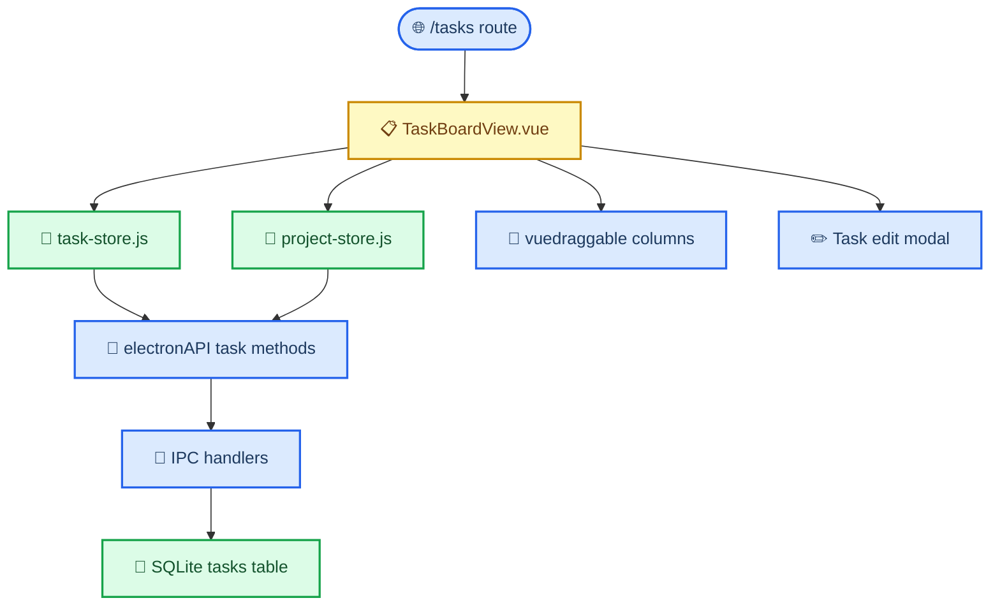
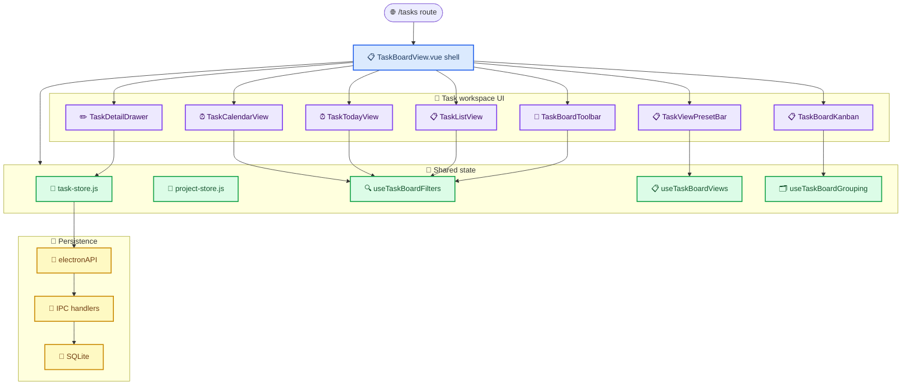
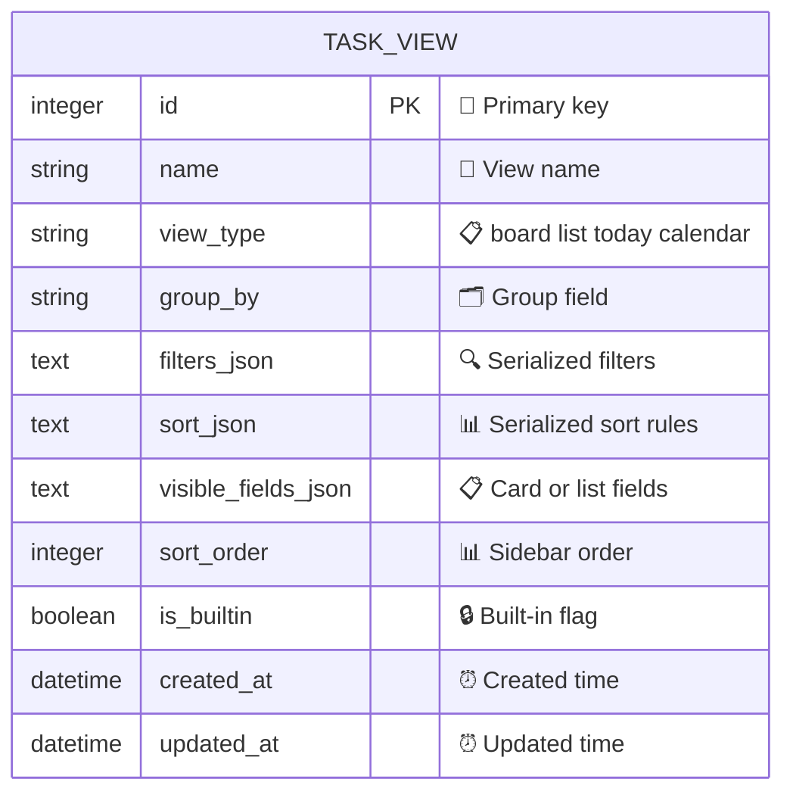
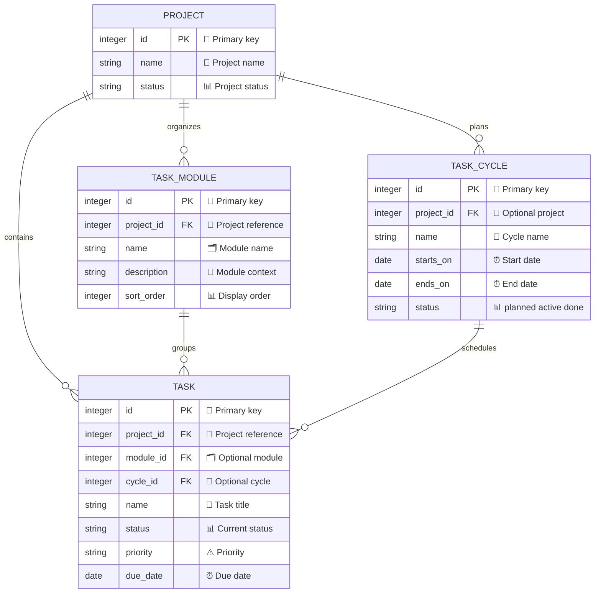
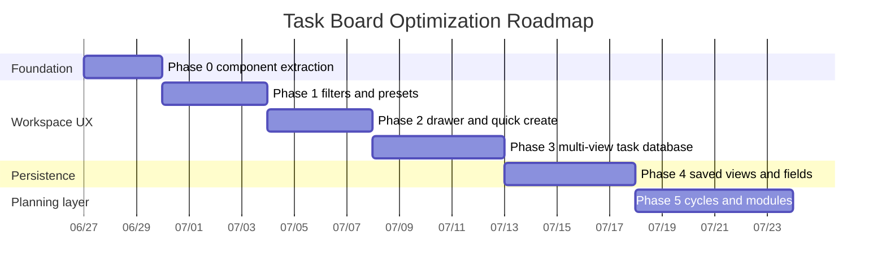

# BongMaster 任务看板优化方案

> **状态更新（2026-11-09）：** 当前产品已改为“任务页仅保留看板 + 独立 `/calendar` 日历页”。本文中列表/今日/日历四视图、Phase 3 及相关路由设计均已停止实施；日历改由独立日历模块承接。保留本文仅作历史设计参考。

_面向 AI Agents 的执行规格，参考 Plane 与 AppFlowy，目标是把当前 `任务看板` 从三列状态板升级为适合个人学术项目管理的多视图任务工作台。_

---

## 🎯 目标与结论

当前 BongMaster 的任务看板已经具备基础 Kanban 能力：三列状态流、拖拽改状态、列内优先级/截止日筛选、顶部即将到期提醒、任务新建与编辑弹窗。它的问题不在于“不能用”，而在于当任务规模、项目数量、学术上下文增加后，三列看板会逐渐失去信息组织能力。

参考 Plane 与 AppFlowy 后，推荐把 `src/views/TaskBoardView.vue` 从一个固定三列页面升级为 **任务数据库的多视图工作台**。Plane 的启发是 Work Items、Cycles、Modules、Views、Analytics 这套围绕任务组织和推进节奏的模型；AppFlowy 的启发是同一批数据库记录可以用 Grid、Board、Calendar 等不同视图呈现，并按字段筛选、排序、分组。[^1][^2][^3][^4]

> **关键决策:** 第一阶段不要急着大改数据库。先在现有 `tasks` 表字段上完成全局筛选、视图切换、卡片密度、右侧详情抽屉和组件拆分。第二阶段再引入保存视图、任务描述、标签、Cycle、Module、子任务和日历所需的 schema 迁移。

### Product north star

任务看板最终应该回答四个问题：

| 问题 | 当前支持程度 | 目标体验 |
| --- | --- | --- |
| 我现在应该做什么？ | 部分支持，依赖到期提醒和状态列 | `今天` 视图集中显示逾期、今天到期、进行中和高优任务 |
| 每个项目推进到哪里了？ | 部分支持，卡片显示 `project_name` | 全局项目筛选、项目分组、项目进度摘要 |
| 这周或这个投稿周期要完成什么？ | 不支持 | Cycle 视图支持本周、投稿前、返修期等工作周期 |
| 一个任务的上下文在哪里？ | 很弱，只有名称、状态、优先级、负责人、日期 | 右侧详情抽屉承载描述、子任务、关联笔记、历史与快捷操作 |

### Recommended implementation path

| Phase | Goal | Database change | User-visible impact |
| --- | --- | --- | --- |
| Phase 0 | 清理结构与建立共享计算层 | No | 降低后续修改风险 |
| Phase 1 | 全局筛选 + 预设视图 + 卡片密度 | No | 看板立刻更好扫、更好找 |
| Phase 2 | 右侧任务详情抽屉 + 快速创建 | No | 编辑不中断上下文，创建更快 |
| Phase 3 | 列表视图 + 今天视图 + 日历轻视图 | No or minimal | 同一批任务可按不同工作场景使用 |
| Phase 4 | 保存视图 + 任务扩展字段 | Yes | 像 Plane/AppFlowy 一样保存工作视角 |
| Phase 5 | Cycle / Module 学术周期模型 | Yes | 从任务管理升级为研究推进系统 |

## 🔍 参考产品拆解

### Plane: issue-first project execution

Plane 是开源项目管理系统，核心概念围绕 Work Items、Cycles、Modules、Views、Pages 和 Analytics。它的可借鉴点不是视觉风格，而是“任务不是孤立卡片，而是可以被组织、过滤、规划和复盘的工作项”。[^1][^2]

| Plane capability | 对 BongMaster 的启发 | 建议转译 |
| --- | --- | --- |
| Work Items | 任务有状态、优先级、负责人、截止日、上下文 | 扩展 `tasks` 为研究任务条目 |
| Cycles | 一段时间内要推进的一组任务 | `本周冲刺`、`投稿前 14 天`、`返修周期`、`考试周` |
| Modules | 任务按功能/主题聚合 | `论文写作`、`数据清洗`、`模型实验`、`文献综述` |
| Views | 保存筛选和排序后的工作视角 | `我的本周`、`高优先级`、`逾期`、`论文 A` |
| Analytics | 看任务完成、负载和推进趋势 | 项目进度、最近完成、逾期风险、每周完成量 |

### AppFlowy: database-first flexible views

AppFlowy 的数据库能力强调同一份数据可以通过 Board、Grid、Calendar 等视图呈现。Board 视图按字段分组，用户可以切换筛选、排序和字段显示，适合 BongMaster 从固定三列看板迁移到“任务数据库”。[^3][^4]

| AppFlowy capability | 对 BongMaster 的启发 | 建议转译 |
| --- | --- | --- |
| Database records | 每个任务是一行结构化记录 | `taskStore.tasks` 作为统一任务数据源 |
| Board view | 按某个字段分组 | 按状态、项目、优先级、负责人、Cycle 分组 |
| Grid view | 高密度表格编辑 | 列表视图支持批量扫任务与快速改字段 |
| Calendar view | 日期字段驱动时间视角 | 按 `due_date` 显示本周、本月任务 |
| Local-first editing style | 轻量、快速、私有 | 优先保证桌面端快速响应和离线可用 |

### What not to copy

不要照搬 Plane 的团队协作复杂度。BongMaster 是个人研究和项目管理桌面应用，第一优先级不是多人权限、评论流、mention、团队工作区，而是减少个人在科研项目推进中的认知负担。

不要照搬 AppFlowy 的通用数据库自由度。BongMaster 不需要做一个完全自由的 Notion-like database。任务字段应该服务学术项目推进，而不是无限自定义字段。

## 🧭 当前实现诊断

### Current file anchors

后续 Agent 在动手前必须读这些文件的当前版本。不要只依赖本文档中的行号；行号会随实现变化。

| File | Responsibility today | Risk if changed carelessly |
| --- | --- | --- |
| `src/views/TaskBoardView.vue` | 当前任务看板页面，包含模板、筛选、拖拽、弹窗、样式 | 页面功能集中，容易一次修改破坏拖拽和保存 |
| `src/stores/task-store.js` | Pinia task store，封装任务列表、创建、更新、删除 | 更新任务状态时还负责记录完成历史 |
| `src/stores/project-store.js` | 项目列表和当前项目数据 | 看板只显示 `未开始` / `进行中` 项目的任务 |
| `electron/services/database-service.js` | SQLite schema 与 task CRUD | schema 扩展必须兼容历史数据库 |
| `electron/preload.js` | Renderer 可调用的 Electron API | 新增 IPC 必须在 preload 暴露 |
| `electron/main.js` | IPC handler 注册 | 新增后端能力必须注册 handler |
| `src/views/DashboardView.vue` | Dashboard 依赖 task 数据做周时间线和项目排名 | 修改 task 字段含义会影响首页统计 |
| `src/views/ProjectDetailView.vue` | 项目详情内也能创建/编辑任务 | 任务表单字段和保存 payload 需要保持兼容 |
| `src/components/daily-task/*` | 每日任务与子任务组件 | 可复用子任务 UI 思路，但不要混淆项目任务与每日任务 |

### Current task schema

当前 `tasks` 表非常轻，字段如下：

| Field | Type | Meaning |
| --- | --- | --- |
| `id` | INTEGER PK | 任务 ID |
| `project_id` | INTEGER FK | 所属项目 |
| `name` | TEXT | 任务名称 |
| `status` | TEXT | `待办` / `进行中` / `已完成` |
| `priority` | TEXT | `高` / `中` / `低` |
| `assignee` | TEXT | 负责人 |
| `due_date` | DATE | 截止日期 |
| `created_at` | DATETIME | 创建时间 |
| `updated_at` | DATETIME | 更新时间 |

Current backend anchors:

| Method | Current behavior |
| --- | --- |
| `getAllTasks()` | `JOIN projects` 返回 `project_name`，按 `created_at DESC` |
| `getTasksByProjectId(projectId)` | 返回某项目任务，当前不 join `project_name` |
| `createTask(data)` | 只插入 `project_id, name, status, priority, assignee, due_date` |
| `updateTask(id, data)` | 只更新 `name, status, priority, assignee, due_date` |
| `deleteTask(id)` | 删除任务 |

### Current UI behavior

| Area | Current implementation | Observed limitation |
| --- | --- | --- |
| Header | `任务看板` + `新建任务` | 缺少搜索、视图切换、全局筛选 |
| Due alert | 顶部横向 chip 列表，最多显示 5 个 | 不是一个可持续的工作队列，超过 5 个后信息被隐藏 |
| Columns | 固定 `待办`、`进行中`、`已完成` | 不能按项目、优先级、负责人、周期分组 |
| Filters | `待办` 和 `进行中` 各自有优先级/日期筛选 | 筛选重复且不一致，`已完成` 无筛选 |
| Cards | 名称、项目、优先级、日期 | 缺少负责人、逾期状态、子任务进度、描述提示 |
| Edit UX | 居中 modal | 打断看板上下文，不适合长描述和关联信息 |
| Drag | `vuedraggable` 拖拽跨列后调用 `updateTask(taskId, { status })` | 只支持改状态，不支持列内顺序持久化 |
| Mobile | `max-width: 992px` 改成单列 | 功能可用，但筛选和卡片密度还不适配长期使用 |

### Current architecture diagram



The most important problem is that `TaskBoardView.vue` owns too many concerns. Refactor toward small, testable UI components and composables before adding advanced features.

## 🏗️ Target architecture

### Target component map

| New or changed file | Responsibility | Phase |
| --- | --- | --- |
| `src/views/TaskBoardView.vue` | Page shell, data loading, view state orchestration | 0-3 |
| `src/components/task-board/TaskBoardToolbar.vue` | Search, global filters, view mode, density toggle, quick actions | 1 |
| `src/components/task-board/TaskBoardKanban.vue` | Board rendering and drag orchestration | 0-1 |
| `src/components/task-board/TaskBoardColumn.vue` | Single lane header, count, empty state, drop zone | 0 |
| `src/components/task-board/TaskCard.vue` | Compact/detailed task card | 0-1 |
| `src/components/task-board/TaskDetailDrawer.vue` | Right-side task create/edit/detail drawer | 2 |
| `src/components/task-board/TaskListView.vue` | High-density table/list view | 3 |
| `src/components/task-board/TaskTodayView.vue` | Today-focused queue | 3 |
| `src/components/task-board/TaskCalendarView.vue` | Lightweight weekly/monthly due-date view | 3 |
| `src/components/task-board/TaskViewPresetBar.vue` | Saved or built-in preset views | 1, 4 |
| `src/composables/useTaskBoardFilters.js` | Global filter state and predicate helpers | 1 |
| `src/composables/useTaskBoardGrouping.js` | Group tasks by status/project/priority/assignee/cycle | 1, 5 |
| `src/composables/useTaskBoardViews.js` | View mode and preset management | 1, 4 |
| `src/composables/useTaskQuickCreate.js` | Quick-create parser and defaults | 2 |
| `src/utils/task-board.js` | Pure helpers: sorting, due status, priority order, display labels | 0 |

### Target architecture diagram



### Desired route behavior

The route can remain `/tasks`. Use local state or query params for view state:

| State | Suggested query param | Examples |
| --- | --- | --- |
| View mode | `view` | `board`, `list`, `today`, `calendar` |
| Preset | `preset` | `due`, `week`, `high`, `mine` |
| Group field | `group` | `status`, `project`, `priority`, `assignee` |
| Search | `q` | task title keyword |
| Project | `project` | project ID |

Use query params only after Phase 1 state is stable. Do not block Phase 1 on router synchronization.

## 🧩 UX specification

### Page layout

Target desktop layout:

```text
┌──────────────────────────────────────────────────────────────────────────┐
│ Header: 任务工作台                         New task / Cmd+K / filters      │
├──────────────────────────────────────────────────────────────────────────┤
│ Presets: 今天 | 逾期 | 本周 | 高优 | 进行中 | 已完成 | 自定义视图           │
├──────────────────────────────────────────────────────────────────────────┤
│ Toolbar: Search | Project | Priority | Assignee | Due | Group | Density   │
├──────────────────────────────────────────────────────────────────────────┤
│ View body: Board / List / Today / Calendar                               │
└──────────────────────────────────────────────────────────────────────────┘
                                     ┌─────────────────────────────────────┐
                                     │ Optional right drawer when task open │
                                     └─────────────────────────────────────┘
```

Target mobile layout:

| Area | Behavior |
| --- | --- |
| Header | Title + primary create button |
| Presets | Horizontally scrollable segmented control |
| Filters | Collapsible sheet or popover |
| Board | One column at a time or stacked columns |
| Drawer | Full-screen sheet |
| Drag | Keep drag if reliable; also provide status select in drawer |

### View modes

| View | Purpose | Required in phase | Notes |
| --- | --- | --- | --- |
| `board` | Status or field-grouped Kanban | 1 | Current default |
| `list` | High-density scanning and bulk mental model | 3 | No bulk editing required initially |
| `today` | Execution queue | 3 | Combines overdue, today, in progress, high priority |
| `calendar` | Deadline awareness | 3 | Weekly view first; monthly later |

### Built-in presets

Implement built-in presets before custom saved views.

| Preset | Filter logic |
| --- | --- |
| `全部活跃` | Active project tasks, optionally hide completed |
| `今天` | `due_date <= today` and not completed, plus active `进行中` tasks |
| `逾期` | `due_date < today` and not completed |
| `本周` | `due_date` between Monday and Sunday of current week and not completed |
| `高优` | `priority === '高'` and not completed |
| `进行中` | `status === '进行中'` |
| `已完成` | `status === '已完成'` |

### Global filters

Replace per-column filters with one global toolbar.

| Filter | UI control | Phase | Notes |
| --- | --- | --- | --- |
| Search | Text input | 1 | Match `name`, later `description`, `tags`, `project_name` |
| Project | Select or multi-select | 1 | Default active projects only |
| Status | Multi-select | 1 | Default all active statuses |
| Priority | Segmented or select | 1 | `全部`, `高`, `中`, `低` |
| Assignee | Select | 1 | Build options from existing task values |
| Due | Select + optional date range | 1 | `全部`, `逾期`, `今天`, `本周`, `无日期`, `自定义` |
| Group by | Menu | 1 | Status first; project/priority later |
| Density | Segmented control | 1 | `紧凑`, `详细` |

### Board grouping

Phase 1 board can still default to status columns. However, structure the code so these groupings become easy:

| Group field | Columns |
| --- | --- |
| `status` | `待办`, `进行中`, `已完成` |
| `priority` | `高`, `中`, `低`, `未设置` |
| `project` | Active project names |
| `assignee` | Assignee names + `未分配` |
| `cycle` | Future: cycle names |
| `module` | Future: module names |

### Task card specification

Compact card:

| Element | Required | Notes |
| --- | --- | --- |
| Task name | Yes | 1-2 lines max |
| Project chip | Yes | Use muted chip, truncate safely |
| Priority indicator | Yes | Left stripe or small badge |
| Due date | If present | Use relative label: `今天`, `明天`, `已逾期`, `06-30` |

Detailed card:

| Element | Required | Notes |
| --- | --- | --- |
| Task name | Yes | 2-3 lines max |
| Project | Yes | Visible project context |
| Priority | Yes | Badge or stripe |
| Due date | If present | Stronger state for overdue |
| Assignee | If present | Text or avatar initial |
| Description indicator | Future | Show small icon when `description` exists |
| Subtask progress | Future | `2/5` once project task subtasks exist |
| Updated time | Optional | Useful in list view more than board |

### Task detail drawer

Replace or supplement the modal with a right-side drawer. The drawer should be the single task editor across board/list/today/calendar.

| Section | Fields |
| --- | --- |
| Header | Task title input, close button, delete/menu |
| Core fields | Project, status, priority, assignee, due date |
| Notes | Future `description` textarea or Markdown editor |
| Planning | Future Cycle, Module |
| Subtasks | Future project-task subtasks |
| Links | Future linked notepad notes or project notes |
| Footer | Save state, delete, duplicate, mark complete |

Drawer behavior:

1. Opening a card should not change current filters or scroll position.
2. `Esc` closes drawer if there are no dirty changes.
3. Dirty changes should be saved explicitly in Phase 2; autosave can come later.
4. Deleting a task closes drawer and removes it from the current view.
5. On mobile, drawer becomes full-screen sheet.

### Quick create

Phase 2 quick create should support three entry points:

| Entry | Default values |
| --- | --- |
| Header `新建任务` | `status: 待办`, project selected from filter if exactly one |
| Column footer `+ 添加任务` | Status from column, project from active filter if exactly one |
| Command / keyboard | Parse inline syntax |

Suggested quick-create syntax:

| Syntax | Meaning |
| --- | --- |
| `写 introduction #论文A !高 @明天` | Name + project + priority + due date |
| `跑 robustness @本周五` | Name + due date |
| `整理数据 !中` | Name + priority |

Do not implement natural language parsing in Phase 2. Start with a small deterministic parser:

| Token | Parse rule |
| --- | --- |
| `!高`, `!中`, `!低` | Priority |
| `@今天`, `@明天`, `@后天` | Due date |
| `@YYYY-MM-DD` | Due date |
| `#projectName` | Match exact project name, fallback unresolved |

### Keyboard shortcuts

| Shortcut | Behavior | Phase |
| --- | --- | --- |
| `C` | Open quick create | 2 |
| `/` | Focus search | 1 |
| `Esc` | Close drawer or clear focused overlay | 2 |
| `Cmd/Ctrl+K` | Future command palette | 5 |
| `Enter` on focused card | Open detail drawer | 2 |
| Arrow keys | Navigate cards in current view | Future |

Do not add global shortcuts while typing inside inputs, selects, textarea, or contenteditable elements.

## 🗄️ Data model roadmap

### Phase 1-3: no schema migration

Use existing fields only:

| Desired feature | Existing field |
| --- | --- |
| Status board | `status` |
| Priority filter | `priority` |
| Project filter | `project_id`, `project_name` from join |
| Assignee filter | `assignee` |
| Date presets | `due_date` |
| Today view | `status`, `priority`, `due_date` |
| Calendar view | `due_date` |
| Completion count | `status === '已完成'`, `updated_at` |

### Phase 4: task extension columns

Add these columns via `ensureColumn` in `electron/services/database-service.js`:

| Column | Type | Default | Purpose |
| --- | --- | --- | --- |
| `description` | TEXT | `''` | Long task context |
| `tags` | TEXT | `''` | Comma-separated or JSON string; choose one and document |
| `sort_order` | INTEGER | `0` | Stable ordering within groups |
| `completed_at` | DATETIME | `NULL` | Accurate completion date |
| `is_archived` | BOOLEAN | `0` | Hide old tasks without deleting |

Schema migration rules:

1. Use existing `ensureColumn` style already present in `database-service.js`.
2. Do not rewrite the `CREATE TABLE` block alone; old databases need `ALTER TABLE` behavior.
3. Update `createTask`, `updateTask`, `getAllTasks`, `getTaskById`, backup merge logic, MCP tools, and AI service tool payloads together.
4. Keep old payloads valid. Missing new fields must default safely.

### Phase 4: saved views

Add a separate table for saved task views.



Do not store built-in presets only in DB. Built-ins should live in code and optionally be mirrored as rows later. This avoids migrations breaking default views.

### Phase 5: Cycle and Module model

Plane's Cycles and Modules should be translated to a personal academic workflow.



Academic examples:

| Generic term | BongMaster label | Example |
| --- | --- | --- |
| Cycle | 周期 | `本周冲刺`, `投稿前 14 天`, `返修第 1 轮`, `期末周` |
| Module | 模块 | `文献综述`, `数据清洗`, `主回归`, `稳健性`, `写作润色` |

### Project task subtasks

There is already a `daily_task_subtasks` table for daily tasks. Do not reuse it blindly for project tasks because its foreign key points to `daily_tasks`.

When adding project task subtasks, use a new table:

| Table | Fields |
| --- | --- |
| `task_subtasks` | `id`, `task_id`, `title`, `is_completed`, `sort_order`, `created_at`, `updated_at` |

Keep component naming distinct:

| Existing | Future |
| --- | --- |
| `DailyTaskSubtaskList.vue` | `TaskSubtaskList.vue` |
| `daily_task_subtasks` | `task_subtasks` |
| `dailyTaskStore.taskSubtasks` | `taskStore.taskSubtasks` or separate `task-subtask-store.js` |

## 🛠️ Implementation plan for AI Agents

### Agent operating protocol

Every Agent working on this plan must follow this protocol:

1. Read this full document before editing files.
2. Inspect the current versions of all files listed in the relevant phase.
3. Use CodeGraph MCP for structural questions when available, per `AGENTS.md`.
4. Keep one phase-sized change per implementation pass.
5. Do not modify database schema before Phase 4 unless the user explicitly approves.
6. Do not remove existing `TaskBoardView.vue` behavior until replacement behavior is verified.
7. Preserve drag-to-status-change behavior in every board refactor.
8. Preserve task completion history behavior in `task-store.js`.
9. Run `npm run build:vite` after each phase.
10. If visual layout changes, run the app and inspect desktop and narrow viewport screenshots.
11. Record any deviations from this plan in the final implementation summary.

### Phase 0: refactor without behavior change

Goal: make current board easier to modify while preserving behavior.

Required file changes:

| File | Change |
| --- | --- |
| `src/utils/task-board.js` | Add pure helpers for priority order, due status, date formatting, active project filter |
| `src/components/task-board/TaskCard.vue` | Extract current card markup and classes |
| `src/components/task-board/TaskBoardColumn.vue` | Extract column header, draggable content, empty state |
| `src/components/task-board/TaskBoardKanban.vue` | Render columns from configuration |
| `src/views/TaskBoardView.vue` | Become page orchestrator, keep modal temporarily |

Acceptance criteria:

- `/tasks` visually matches current behavior closely.
- Three columns still show `待办`, `进行中`, `已完成`.
- Dragging between columns still calls `taskStore.updateTask(taskId, { status })`.
- Recently moved/completed flash still works or is intentionally simplified with equivalent feedback.
- Creating, editing, deleting tasks still works.
- `npm run build:vite` passes.

Implementation notes:

- Convert repeated column template into a `columns` computed array:

```js
const boardColumns = computed(() => [
  {
    key: 'todo',
    status: '待办',
    title: '待办',
    badgeClass: 'bm-badge-slate',
    tasks: todoList.value,
    count: filteredTodoTasks.value.length,
    filterEnabled: true
  },
  ...
])
```

- Do not try to implement new features in Phase 0.
- Keep CSS class names stable where possible to reduce visual churn.

### Phase 1: global toolbar, presets, card density

Goal: replace duplicated per-column filters with a global task workspace toolbar.

Required file changes:

| File | Change |
| --- | --- |
| `src/composables/useTaskBoardFilters.js` | Global filter state and `filterTasks(tasks, projects)` |
| `src/composables/useTaskBoardViews.js` | Built-in presets and view state |
| `src/components/task-board/TaskBoardToolbar.vue` | Search and filter controls |
| `src/components/task-board/TaskViewPresetBar.vue` | Built-in preset buttons |
| `src/components/task-board/TaskCard.vue` | Add compact/detailed density |
| `src/views/TaskBoardView.vue` | Wire filters and presets |

Filter object:

```js
const filters = reactive({
  search: '',
  projectIds: [],
  statuses: [],
  priorities: [],
  assignees: [],
  dueMode: 'all',
  dueBefore: '',
  includeCompleted: true,
  activeProjectsOnly: true
})
```

Preset object:

```js
const builtInPresets = [
  { key: 'active', label: '全部活跃', patch: { activeProjectsOnly: true } },
  { key: 'today', label: '今天', patch: { dueMode: 'today_or_overdue', includeCompleted: false } },
  { key: 'overdue', label: '逾期', patch: { dueMode: 'overdue', includeCompleted: false } },
  { key: 'week', label: '本周', patch: { dueMode: 'this_week', includeCompleted: false } },
  { key: 'high', label: '高优', patch: { priorities: ['高'], includeCompleted: false } },
  { key: 'progress', label: '进行中', patch: { statuses: ['进行中'] } },
  { key: 'done', label: '已完成', patch: { statuses: ['已完成'], includeCompleted: true } }
]
```

Acceptance criteria:

- One toolbar controls all columns.
- Search filters by task name and project name.
- Built-in presets work and are visibly active.
- `待办`, `进行中`, `已完成` counts reflect active filters.
- Card density toggle works.
- Per-column filters are removed or hidden.
- `npm run build:vite` passes.

### Phase 2: task detail drawer and quick create

Goal: replace modal-first editing with contextual editing.

Required file changes:

| File | Change |
| --- | --- |
| `src/components/task-board/TaskDetailDrawer.vue` | Full create/edit drawer |
| `src/composables/useTaskQuickCreate.js` | Deterministic quick-create parser |
| `src/components/task-board/TaskQuickCreate.vue` | Inline or popover quick task entry |
| `src/views/TaskBoardView.vue` | Manage `selectedTaskId`, `drawerMode`, quick-create defaults |

Drawer state:

```js
const selectedTaskId = ref(null)
const drawerMode = ref('closed') // closed | create | edit
const drawerDefaults = ref({})
```

Expected drawer props:

| Prop | Meaning |
| --- | --- |
| `show` | Drawer visible |
| `task` | Existing task or null |
| `projects` | Project options |
| `defaults` | Defaults for create mode |

Expected drawer emits:

| Emit | Payload |
| --- | --- |
| `close` | none |
| `save` | task payload |
| `delete` | task ID |
| `duplicate` | future |

Acceptance criteria:

- Clicking a card opens right drawer instead of modal.
- Header `新建任务` opens drawer in create mode.
- Column footer `+ 添加任务` opens drawer with column status default.
- Existing modal can remain temporarily behind a fallback flag, but main path must be drawer.
- `Esc` closes drawer when not dirty.
- Task create/update/delete still use `taskStore`.
- `npm run build:vite` passes.

### Phase 3: list, today, and calendar views

Goal: make the task database usable outside board mode.

Required file changes:

| File | Change |
| --- | --- |
| `src/components/task-board/TaskListView.vue` | Table/list rendering |
| `src/components/task-board/TaskTodayView.vue` | Execution queue |
| `src/components/task-board/TaskCalendarView.vue` | Weekly due-date view |
| `src/components/task-board/TaskBoardToolbar.vue` | View mode segmented control |
| `src/views/TaskBoardView.vue` | Conditional view rendering |

List view columns:

| Column | Editable in Phase 3? |
| --- | --- |
| Task name | Opens drawer, not inline |
| Project | No |
| Status | Optional inline select |
| Priority | Optional inline select |
| Assignee | No |
| Due date | Optional inline date |

Today view sections:

| Section | Logic |
| --- | --- |
| 逾期 | `due_date < today` and not completed |
| 今天到期 | `due_date === today` and not completed |
| 进行中 | `status === '进行中'` and not completed |
| 高优无日期 | `priority === '高'` and no due date and not completed |

Calendar view:

- Start with week view only.
- Reuse `DashboardView.vue` week logic where appropriate.
- Each day cell lists due tasks.
- Click task opens drawer.
- Click empty day with `+` opens create drawer with `due_date` default.

Acceptance criteria:

- Toolbar can switch `board`, `list`, `today`, `calendar`.
- All views respect global filters.
- Clicking any task opens the same drawer.
- Calendar is readable at desktop width and degrades gracefully on mobile.
- `npm run build:vite` passes.

### Phase 4: schema extensions and saved views

Goal: persist richer task context and user-defined views.

Required backend changes:

| File | Change |
| --- | --- |
| `electron/services/database-service.js` | Add columns, create `task_views`, update CRUD |
| `electron/preload.js` | Expose task view APIs |
| `electron/main.js` | Register task view IPC handlers |
| `src/stores/task-store.js` | Include new task fields |
| `src/stores/task-view-store.js` | New Pinia store for saved views |
| `electron/services/mcp-server.js` | Optional: expose list/create/update task views |
| `electron/services/ai-service.js` | Optional: update tool schema for new fields |

Suggested IPC API:

| API | Purpose |
| --- | --- |
| `getTaskViews()` | List saved views |
| `createTaskView(data)` | Save current filters/sort/group |
| `updateTaskView(id, data)` | Rename or update view config |
| `deleteTaskView(id)` | Delete user view |

Acceptance criteria:

- Existing databases migrate without data loss.
- Existing task create/update calls still work when new fields are omitted.
- Drawer can edit `description` and `tags`.
- Users can save current filters as a named view.
- Saved views survive app restart.
- Backup/restore merge does not drop new task fields.
- `npm run build:vite` passes.

### Phase 5: Cycle and Module

Goal: support personal academic planning beyond status tracking.

Required changes:

| Area | Change |
| --- | --- |
| Database | Add `task_cycles`, `task_modules`, `cycle_id`, `module_id` |
| Store | Add stores or methods for cycles/modules |
| UI | Add cycle/module filters and management dialogs |
| Board | Support grouping by cycle or module |
| Drawer | Add cycle/module fields |
| Analytics | Add cycle completion and module progress summaries |

Acceptance criteria:

- User can create a cycle with start/end dates.
- User can assign tasks to cycle.
- User can create modules per project.
- Board/list can filter and group by cycle/module.
- Today view highlights active cycle tasks.
- `npm run build:vite` passes.

## 🎨 Visual design direction

### Overall tone

BongMaster is a productivity and research tool. Keep the interface quiet, dense, and operational. Avoid landing-page composition, decorative hero sections, oversized cards, or single-hue novelty palettes. The board should feel like a calm instrument panel for work.

### Layout rules

| Rule | Rationale |
| --- | --- |
| Keep toolbar compact | Users will use this daily, not admire it once |
| Prefer icons for repeated controls | Saves horizontal space |
| Use text labels for filters | Reduces ambiguity in Chinese UI |
| Keep cards under 8px radius | Matches existing `bongmaster.css` rhythm |
| Avoid nested cards | Board columns already frame content |
| Reserve strong color for state | Red only for overdue/high-risk, green only for completion |

### Interaction states

| State | Required feedback |
| --- | --- |
| Hover card | Slight background/border change, no layout shift |
| Drag card | Clear ghost/chosen state |
| Drop success | Short non-disruptive flash |
| Save in drawer | Disable save button or show `保存中` |
| Error | Inline error near action, not only `alert()` in new code |
| Empty column | Useful `+ 添加任务` action |

### Accessibility checklist

- All icon-only buttons must have `aria-label`.
- Toolbar controls must have visible labels or accessible labels.
- Drawer close button must be keyboard reachable.
- Card focus state must be visible.
- Text contrast must meet 4.5:1 for normal text.
- Touch targets should be at least 44px on mobile.
- Do not rely on color alone for priority or overdue state.
- Respect `prefers-reduced-motion` for flashing and drag animations.

## 🧪 Testing and verification

### Required manual checks

Run these after every phase:

1. `npm run build:vite`
2. Launch app with `npm run dev` if the phase changes UI behavior.
3. Create a task from `/tasks`.
4. Edit the task title, project, status, priority, assignee, due date.
5. Drag the task from `待办` to `进行中`.
6. Drag the task to `已完成` and verify completion state.
7. Delete a task.
8. Confirm `/dashboard` still renders active task summaries.
9. Confirm a project detail page can still create/edit tasks.

### Suggested automated tests

This repo may not currently have a full test harness. If adding tests, start with pure helper tests because they are stable and cheap.

| Test target | Cases |
| --- | --- |
| `src/utils/task-board.js` | due status, priority sort, active project filter |
| `useTaskBoardFilters.js` | search, project, status, priority, due modes |
| `useTaskQuickCreate.js` | parse `!高`, `@明天`, `@YYYY-MM-DD`, `#project` |
| `task-store.js` | completion history still records only on transition to `已完成` |

### Visual regression checklist

Inspect at these widths:

| Width | Expected behavior |
| --- | --- |
| 1440px | Full board with toolbar and three columns |
| 1024px | Board still readable, toolbar wraps cleanly |
| 768px | Columns stack or become horizontally manageable |
| 375px | No text overflow, drawer becomes full-screen sheet |

### Data safety checks for schema phases

Before Phase 4 or later:

1. Back up the local SQLite database.
2. Run migration on a copy first if possible.
3. Verify old tasks still load.
4. Create a task with old payload shape.
5. Create a task with new fields.
6. Update only `status` and confirm other fields are preserved.
7. Run backup/restore path if modified.

## ⚠️ Risks and mitigation

| Risk | Phase | Mitigation |
| --- | --- | --- |
| Drag behavior breaks during component extraction | 0 | Keep `vuedraggable` event contract and test cross-column movement immediately |
| Filters become hard to reason about | 1 | Centralize filter logic in one composable and keep pure helper tests |
| Drawer introduces unsaved changes confusion | 2 | Start with explicit Save/Cancel, add autosave later only if needed |
| Calendar becomes too much work | 3 | Implement week view first, no full month complexity |
| Schema migration drops data | 4 | Use additive `ensureColumn`; never destructive migration |
| Saved views become incompatible | 4 | Version saved view config JSON |
| Cycle/Module overcomplicates personal workflow | 5 | Keep optional and project-scoped; do not force every task into a cycle |
| AI/MCP tools break with new fields | 4-5 | Update `mcp-server.js` and `ai-service.js` schemas in same phase as backend |

## 🚫 Non-goals

Do not implement these unless the user explicitly asks:

- Multi-user permissions
- Comments and mentions
- Cloud sync
- Full custom fields database builder
- Rich text task descriptions
- External issue tracker integrations
- Full Gantt chart UI
- Real-time collaboration
- Deleting the existing task workflow before replacement is verified

## 🗺️ Roadmap overview



Dates in this Gantt are illustrative sequencing only, not a commitment. Agents should use phase order and acceptance criteria as the source of truth.

## 📋 Implementation checklist

### Phase 0 checklist

- [ ] Create `src/components/task-board/`
- [ ] Create `src/utils/task-board.js`
- [ ] Extract `TaskCard.vue`
- [ ] Extract `TaskBoardColumn.vue`
- [ ] Extract `TaskBoardKanban.vue`
- [ ] Keep current modal editing path
- [ ] Verify drag across all three statuses
- [ ] Run `npm run build:vite`

### Phase 1 checklist

- [ ] Create `useTaskBoardFilters.js`
- [ ] Create `useTaskBoardViews.js`
- [ ] Add `TaskBoardToolbar.vue`
- [ ] Add `TaskViewPresetBar.vue`
- [ ] Remove duplicated per-column filters
- [ ] Add search
- [ ] Add project filter
- [ ] Add priority filter
- [ ] Add due-date presets
- [ ] Add density toggle
- [ ] Run `npm run build:vite`

### Phase 2 checklist

- [ ] Add `TaskDetailDrawer.vue`
- [ ] Replace card click modal path with drawer path
- [ ] Add create drawer path
- [ ] Add column footer quick create
- [ ] Add deterministic quick-create parser
- [ ] Add `Esc` close behavior
- [ ] Preserve delete behavior
- [ ] Run `npm run build:vite`

### Phase 3 checklist

- [ ] Add view mode segmented control
- [ ] Add `TaskListView.vue`
- [ ] Add `TaskTodayView.vue`
- [ ] Add `TaskCalendarView.vue`
- [ ] Ensure all views respect filters
- [ ] Ensure all views open same drawer
- [ ] Run `npm run build:vite`

### Phase 4 checklist

- [ ] Add task extension columns with `ensureColumn`
- [ ] Update backend task CRUD
- [ ] Update preload/main IPC if needed
- [ ] Add `task_views` table
- [ ] Add task view APIs
- [ ] Add `task-view-store.js`
- [ ] Add save/update/delete view UI
- [ ] Update backup/restore merge for new fields
- [ ] Update MCP/AI tools if task payload schema changes
- [ ] Run `npm run build:vite`

### Phase 5 checklist

- [ ] Add cycle/module tables
- [ ] Add cycle/module stores
- [ ] Add cycle/module management UI
- [ ] Add drawer fields
- [ ] Add filters/grouping
- [ ] Add analytics summaries
- [ ] Update MCP/AI tools
- [ ] Run `npm run build:vite`

## 🧾 References

[^1]: makeplane. "Plane." GitHub repository. https://github.com/makeplane/plane

[^2]: Plane. "Plane documentation." https://docs.plane.so/

[^3]: AppFlowy-IO. "AppFlowy." GitHub repository. https://github.com/AppFlowy-IO/AppFlowy

[^4]: AppFlowy. "Database views and architecture documentation." https://docs.appflowy.io/docs/documentation/software-contributions/architecture/frontend/database-view/kanban-board
